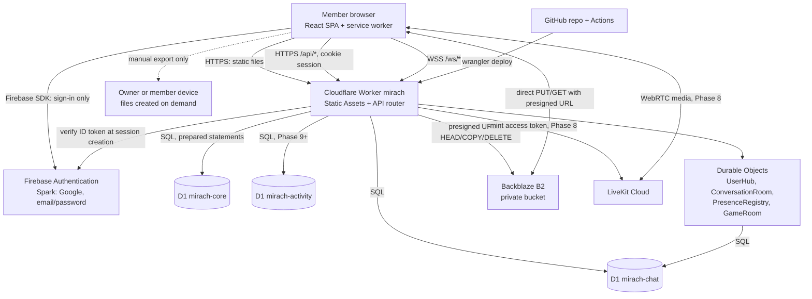
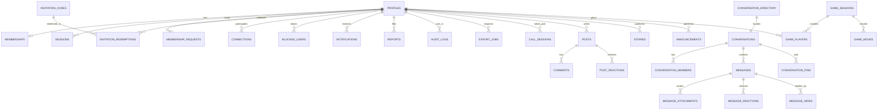
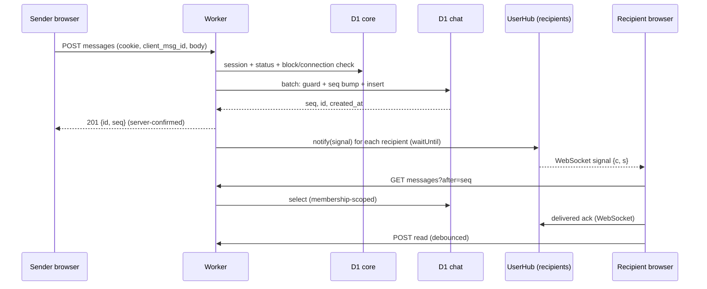

# Architecture — Mirach (v3: serverless, cloud-authoritative, no-card)

> **Status:** Planning baseline v3 for owner approval and freeze. Nothing here is built, activated or tested.
> **Last reviewed:** 4 November 2026; consistency pass v3.1 on 9 November 2026 (Asia/Kolkata) — see `REVIEW_REPORT.md` §14.
> **Supersedes:** v2 (Supabase-based). v2 files are kept in `_previous_v2_2026-11-04/`.
> **Evidence:** provider facts are dated snapshots in `SOURCE_REGISTER.md`. Anything not verified is **UNVERIFIED**.

## 1. Goals and hard constraints

Mirach is a private, invitation-only community messenger and social platform with calls, games, stories and feeds, used from desktop, laptop, tablet and mobile browsers.

**Owner constraints (binding):**
1. **Cloud is the sole authoritative store** of all application data (§4). The owner's computer is never a server, database, archive, sync target or required backup service.
2. **Serverless**, on providers that can be activated **without a credit/debit card** and used at **zero monthly cost**.
3. Invitation-code **and** admin-approved registration; Google **and** email/password sign-in; no phone numbers.
4. Data leaves the cloud for a personal device only through **manual, user-initiated exports** (`EXPORT_SPECIFICATION.md`).
5. All requested features are assigned to phases (`Phases.md` §3); none is silently dropped.
6. After approval the architecture is **frozen** (§22, `Rules.md` §2).

**Priorities:** security → correctness → reliability → maintainability → user experience → cost → scalability.

**Honest consequence of "no card":** a provider's paid plan can never be reached by accident. When a free quota is exhausted the service **fails closed (outage), it does not bill**. The design therefore treats quota exhaustion as a first-class failure mode (§19).

## 2. Technology stack (selected, with card status)

| Layer | Selected | Alternatives considered / rejected | Free limits that matter (checked 4 Nov 2026) | No-card status |
|---|---|---|---|---|
| Frontend | React + TypeScript (strict) + Vite SPA; Tailwind CSS; React Router; TanStack Query; Zod; PWA manifest + service worker (Phase 7–8) | Next.js (no SSR need; adds server runtime) | Static assets: 20,000 files per Worker version; static asset requests are free | n/a |
| Hosting + API | **One Cloudflare Worker** serving Static Assets (SPA fallback) and `/api/*`, `/ws/*` routes; assigned `*.workers.dev` URL | GitHub Pages (static-only, no custom headers); Cloudflare Pages (fallback); Vercel/Netlify | Workers Free: **100,000 requests/day** (account-wide, resets 00:00 UTC), **10 ms CPU/invocation**, **50 subrequests/invocation**, 128 MB memory, 3 MB compressed script; request error 1027 when daily limit is exceeded | **Verified** (Cloudflare pricing: "no credit card required") |
| Identity | **Firebase Authentication (Spark)**: Google + email/password; email verification; password reset | Supabase Auth, Appwrite, Clerk (not needed) | Spark: verification emails 1,000/day; password-reset emails 150/day; **email-link sign-in 5/day (not used)**; account creation 100/hour/IP; no phone/SMS; no MFA without the Identity Platform upgrade (not planned) | Spark plan is no-cost; card not required (**secondary source**) |
| Primary database | **Cloudflare D1** (SQLite): `mirach-core`, `mirach-chat`, later `mirach-activity` | Durable Objects as DB (rejected); Turso/Supabase (extra providers) | **500 MB per database**, 10 databases, **5 GB account total**; **5 M rows read/day, 100 k rows written/day** (account-wide; index writes count); **50 queries per Worker invocation** (a `batch()` counts as one); row/string ≤ 2 MB; statement ≤ 100 KB; ≤ 100 bound params; Time Travel 7 days | Included in Workers Free |
| Realtime/ephemeral | **Durable Objects (SQLite-backed, WebSocket Hibernation)** | Polling; Pusher/Ably (extra provider) | DO Free: **100,000 requests/day** (HTTP, RPC, alarms; WebSocket messages billed 20:1), **13,000 GB-s/day**, 5 GB SQLite storage, 30 s CPU per invocation; Free allows **SQLite-backed DOs only** | Included in Workers Free |
| Media storage | **Backblaze B2** private bucket (S3-compatible, presigned URLs) | **Cloudflare R2: payment method requested at activation → rejected**; Firebase Storage (billing plan); Supabase Storage (extra provider, fallback only) | 10 GB free; free egress up to 3× average monthly stored data; free API transactions | **Sign-up page says no credit card required**, but activation and the egress behavior of a no-card account are **UNVERIFIED until the owner's Phase 0 activation test** (Gate P) |
| Calls | **LiveKit Cloud Build** (Phase 8) | Cloudflare Realtime SFU/TURN (1,000 GB/month free; card requirement unverified); native P2P WebRTC | 5,000 WebRTC participant-minutes, 50 GB transfer, 100 concurrent participants; **hard cap** (requests fail until monthly reset) | **Official pricing page: "No credit card required"** |
| Push (Phase 7) | Web Push (VAPID) from the Worker/Durable Objects | FCM-native SDKs, OneSignal | No service fee; iOS needs the web app added to the Home Screen (iOS 16.4+) | No account needed |
| Source / CI | GitHub (private) + GitHub Actions; deploy with Wrangler | GitLab | Actions minutes for private repos: **UNVERIFIED** | Free plan |
| Tests | Vitest + Cloudflare Workers test pool (verify package/version at Phase 1), Playwright, Axe | — | — | — |
| Worker libraries (each needs an approved dependency record, `Rules.md` §6) | `jose` (JWT verification), `zod`, an S3 SigV4 signer (`aws4fetch` or equivalent), `chess.js` (Phase 9, inside a Durable Object) | Hand-rolled crypto (rejected) | Worker bundle must stay < 3 MB gzip | — |

**Optional:** Web Push; PWA install; LiveKit (calls); a custom domain (not needed). **Highest lock-in:** D1 SQL semantics + Durable Objects + Worker bindings (mitigated by SQL migrations and a thin `src/worker/data` layer); Firebase user IDs (mitigated by storing only the UID in D1).

**Documented limitation of using the provider-assigned `*.workers.dev` hostname:** URLs are less polished, the Cloudflare account subdomain is visible to users, and Firebase Auth must be configured with that authorized domain (**UNVERIFIED** for `workers.dev` subdomains; Phase 1 spike). A purchased domain is **not** required and is not planned.

## 3. System architecture



### 3.1 Trust boundaries and responsibilities

| Component | Responsible for | Never |
|---|---|---|
| **Browser** (untrusted) | UI; client validation for UX; Firebase sign-in; image/video/voice processing; local drafts/outbox; assembling export files | Authorization decisions; secrets; trusting its own state; setting sender, role, seq, results |
| **Worker** (authoritative logic) | Session validation; policy checks; every D1 query; signing B2 URLs; signal fan-out; rate limiting; audit | Hold plaintext passwords; accept identity from a request body |
| **D1** (authoritative data) | Persistent structured records and constraints | Store media bytes |
| **Durable Objects** | WebSocket coordination, typing, presence, game turn serialization, call signaling | Be the permanent message store; decide authorization without Worker-verified identity |
| **B2** | Private media objects | Be reachable without a short-lived signed URL |
| **Firebase** | Proving who the user is (sign-in, verification, reset) | Hold community data or decide membership |
| **Owner's PC** | Nothing, unless the owner clicks Export | Be an automatic destination (§4) |

Security never depends on hiding frontend code. There is no row-level security in D1; **all authorization lives in the Worker policy layer and in SQL predicates** (§8).

## 4. Cloud-authoritative data principle (frozen)

- The cloud databases and cloud object storage are the **only** authoritative store. Normal operation never touches the owner's computer. The platform works whether the owner's PC is on, off or offline.
- **Removed from scope (do not reintroduce without owner approval):** background synchronization services, archive collection, sync queues, automatic chat transfer to a PC, post-archive cleanup, local database replication, home-server health checks, Cloudflare Tunnel to a home archive, automatic media download, and **any "delete after 24 hours" rule**. The owner's existing MySQL and MongoDB are untouched and unrelated.
- **Retention:** data persists until (a) an authorized user deletion, (b) an authorized moderation action, (c) an owner-approved retention rule (§7.6), or (d) a documented provider limit forces an explicit operational decision. **Exporting never deletes or alters cloud data.**
- **Local data exists only as:** the browser's short-lived cache, an explicitly labeled unsent-message outbox and drafts (§19.4), and files the user chooses to export. None is authoritative or presented as server-confirmed.
- **Recovery without a local copy:** D1 Time Travel (7 days on Free) and owner-initiated exports (§18). B2 media has no automatic backup; this is a stated limitation.

## 5. Authentication and sessions

### 5.1 Methods

| Method | Decision |
|---|---|
| Google sign-in (Firebase) | Supported from Phase 3 |
| Email + password (Firebase) | Supported from Phase 3; **email verification mandatory** before a Mirach session is created; Firebase-sent verification and reset emails (Spark limits above) |
| Email-link / magic link | Not used (Spark allows 5 per day) |
| Phone number / SMS | Never |
| MFA | Not available on Spark without the Identity Platform upgrade; **UNVERIFIED** whether that upgrade needs billing; not planned (documented limitation) |
| Passkeys | Not offered (future-enhancement backlog) |
| Username | Application identity only, never credentials. Invitation codes are enrollment credentials, not identity |

Account linking: keep Firebase's "one account per email" behavior; a Google and a password sign-in for the same verified email resolve to the same Firebase UID. Test takeover scenarios (unverified-email password account vs Google) in Phase 3 (**UNVERIFIED** behavior). Enable email-enumeration protection and a minimum password policy in Firebase if the console offers them (**UNVERIFIED**); the client enforces ≥ 10 characters regardless.

### 5.2 Why a Mirach session after Firebase sign-in

Firebase proves identity; Mirach authorizes. After sign-in the browser sends the **Firebase ID token once** to `POST /api/session`. The Worker validates it and issues a **Mirach server-side session**: a 256-bit random opaque token delivered as an `HttpOnly; Secure; SameSite=Strict; Path=/` cookie named `__Host-mirach_sid`; only `HMAC-SHA256(token, SESSION_PEPPER)` is stored in `sessions` (D1). Reasons:
- per-device revocation, **"sign out of all devices"** and **immediate suspension** without needing Firebase Admin credentials;
- no bearer token readable by JavaScript (limits XSS theft);
- WebSocket upgrades authenticate with the same cookie (plus an `Origin` check);
- the hot path needs no RSA verification (10 ms CPU limit) — one SQL lookup that is needed anyway for membership.

The Firebase web SDK is set to `inMemoryPersistence` and signs out immediately after `POST /api/session` succeeds, so no Firebase token is stored in the browser after sign-in (re-authentication simply asks the user to sign in again).

Session rules: idle timeout 14 days, absolute lifetime 60 days, ≤ 10 active sessions per user (oldest revoked), `last_used_at` written at most once per hour (write-budget protection), `reauth_at` set when a fresh sign-in is proven.

### 5.3 Firebase ID-token validation (exact method)

Performed only in `POST /api/session` and `POST /api/session/reauth`, inside the Worker, with `jose` (algorithms restricted to `RS256`):
1. Header `alg` = `RS256` and `kid` present; select the key from Google's published Firebase signing keys (the Firebase docs name the x509 endpoint `https://www.googleapis.com/robot/v1/metadata/x509/securetoken@system.gserviceaccount.com`; the JWK form `https://www.googleapis.com/service_accounts/v1/jwk/securetoken@system.gserviceaccount.com` is what JWT libraries consume — confirm in the Phase 3 spike). Cache keys using the response `Cache-Control: max-age`; refresh once on an unknown `kid`.
2. Signature valid for that key.
3. `iss` equals `https://securetoken.google.com/<FIREBASE_PROJECT_ID>`.
4. `aud` equals `<FIREBASE_PROJECT_ID>` (staging and production use **different Firebase projects**, so tokens from one environment never work in the other).
5. `exp` in the future, `iat` in the past, `auth_time` in the past; allow ≤ 60 s clock skew.
6. `sub` is a non-empty string ≤ 128 characters → this is the **Firebase UID** (the Mirach `user_id`).
7. `firebase.sign_in_provider` ∈ {`google.com`, `password`}; anonymous and any other provider are rejected.
8. If provider is `password`, `email_verified` must be `true`.
9. For `reauth`: `auth_time` within the last 5 minutes, and `sub` equals the session's user.
10. The profile for that `sub` must not be tombstoned/deleted; its membership state determines what the session may do.
11. Email is **never stored** in D1 and never returned by any API (it stays in Firebase), reducing exposure and export contents.
Failures return a generic 401; details go to protected logs without the token.

### 5.4 Session lifecycle

| Event | Behavior |
|---|---|
| Sign-in | Firebase sign-in → `POST /api/session` → cookie; the SPA then calls `/api/bootstrap` |
| Expiry | 401 → SPA clears client caches and shows sign-in; outbox is preserved but marked unsent (§19.4) |
| Sign out | `DELETE /api/session` revokes this session row and signs out of Firebase on the client |
| Sign out everywhere | revokes all rows for the user; open sockets receive `revoked` and are closed |
| Suspension | membership set to `suspended`; sessions revoked; `UserHub.evict()` closes sockets; every later request fails the status gate |
| Account deletion | §7.6 |
| CSRF | `SameSite=Strict`, `__Host-` prefix, mandatory `Origin`/`Sec-Fetch-Site` same-origin check and a custom request header on every state-changing call; JSON-only bodies |

Optional hardening (Phase 3 spike, **UNVERIFIED**): use a Firebase service account (Worker secret) to revoke refresh tokens and delete the Firebase user through the Identity Toolkit Admin API. **Fallback if unavailable or unsuitable:** the D1 tombstone blocks session creation for deleted/suspended UIDs; orphaned Firebase accounts are removed by the owner from the Firebase console on the monthly checklist. No Firebase Cloud Functions are used.

## 6. Membership, roles and permissions

States: **identity** (Firebase) ≠ **membership** (`pending | active | rejected | suspended | left`) ≠ **connection** ≠ **conversation membership**. Roles: `owner > admin > moderator > member`.

**Registration rules**
- Valid invitation → `active`, unless `community_settings.require_admin_approval_for_all` → `pending`.
- No invitation → `pending` + a membership request; an admin approves/rejects; rejected users may re-apply after 30 days.
- Invitation codes: ≥ 80-bit random, shown once, stored as hash only, default 1 use / 7 days, grant `member` only; redeemed atomically (§8.3); ≤ 5 failed attempts/hour/user; generic errors.
- Owner bootstrap: one-time `bootstrap_owner` operation run by the owner with a CLI-supplied Firebase UID after the first sign-in; refuses if an owner exists. Hierarchy rules: no self-role change; admins cannot act on owners; only owners create admins; the last owner cannot be demoted/removed. Break-glass recovery = owner uses Wrangler against D1 under `docs/runbooks/owner-recovery.md`, writing an audit row.

**Permission matrix** (✔ allowed, ✘ denied, own = own data only)

| Capability | Applicant (pending/rejected) | Member | Group admin (in that group) | Moderator | Admin | Owner |
|---|:-:|:-:|:-:|:-:|:-:|:-:|
| Own profile, privacy settings, own status | ✔ limited | ✔ | ✔ | ✔ | ✔ | ✔ |
| Directory, connections, blocks | ✘ | ✔ own | ✔ | ✔ | ✔ | ✔ |
| Conversations/messages/media | ✘ | participant only | participant only (+ remove members, remove others' messages in their group) | **participant only** | **participant only** | **participant only** |
| Reports (file) | ✘ | ✔ | ✔ | ✔ | ✔ | ✔ |
| Reports queue + evidence snapshots | ✘ | ✘ | ✘ | ✔ (dismiss/warn/escalate) | ✔ (+ suspend) | ✔ |
| Invitations, requests, members, settings | ✘ | ✘ | ✘ | ✘ | ✔ | ✔ |
| Roles | ✘ | ✘ | ✘ | ✘ | moderators only | ✔ all |
| Audit log (read) | ✘ | ✘ | ✘ | ✘ | ✔ | ✔ |
| **Export own data / chosen conversations** | ✘ | ✔ | ✔ | ✔ | ✔ | ✔ |
| **Administrative report export** (no private content) | ✘ | ✘ | ✘ | ✘ | ✔ | ✔ |
| **Operator export (may include private content)** | ✘ | ✘ | ✘ | ✘ | ✘ | ✔ with re-auth, typed confirmation, mandatory encryption, audit (`EXPORT_SPECIFICATION.md` §5) |

No role grants *application* access to others' private conversations; moderation uses report evidence snapshots (§7.5). The owner's *technical* ability to read data through provider consoles is acknowledged in §15.6 and disclosed to members.

## 7. Data architecture

### 7.1 Database layout (D1, SQLite)

| Database | Contains | Created |
|---|---|---|
| `mirach-core` | identity, membership, invitations, connections, blocks, sessions, settings, reports, audit, notifications, push subscriptions, export jobs, call records, conversation directory | Phase 2 |
| `mirach-chat` | conversations, conversation members, messages, attachments, reactions, pins, hides | Phase 2 schema stub, used from Phase 5 |
| `mirach-activity` | posts, comments, reactions, stories, announcements, games, quizzes | Phase 9 |

The Worker data layer accesses each group through its own binding (`DB_CORE`, `DB_CHAT`, `DB_ACTIVITY`). **In local and staging environments all three bindings may point to one D1 database**, which keeps the 10-database free limit available for production chat shards. Cross-group references are **logical** (no foreign keys across groups) so groups can be split without schema surgery. Within a group, foreign keys are enforced.

**Why separate chat from core:** messages are the dominant growth. A 500 MB limit applies per database; the chat group has a **shard-ready** design: `conversation_directory.shard_id` (core) records which chat database holds each conversation. The shard count is 1 at launch. Adding a shard (≤ 6 more within the 10-database cap) needs an ADR and owner approval; existing conversations never move automatically. Account-wide storage stays capped at 5 GB, so total chat capacity is bounded (§19.5).

### 7.2 Conventions

- IDs: `TEXT` UUID v4 from `crypto.randomUUID()`; users are keyed by the **Firebase UID** (≤ 128 chars). Timestamps: `INTEGER` Unix milliseconds UTC. `STRICT` tables where supported. Boolean as `INTEGER CHECK (x IN (0,1))`.
- All SQL uses **prepared statements with bound parameters**; no string-built SQL; list inputs are bounded and expanded into fixed-size placeholders.
- **Write minimization (100 k rows/day, index writes count):** index only what queries need; avoid indexes on frequently updated columns; derive counts instead of storing mutable counters where practical; coalesce read/delivered cursor updates; keep presence in Durable Objects, not D1.
- Every list endpoint uses cursor pagination and a hard page size; no unbounded scans.
- Migrations: ordered SQL files applied with Wrangler to local → staging → production; tested from scratch in CI. File names are unique across `core`, `chat` and `activity` (`core_0001_…`, `chat_0001_…`) because staging uses one database for all three bindings (`Rules.md` §17).

### 7.3 Entity relationship diagram



Group boundaries (logical, no cross-group FKs): **core** = profiles … call_sessions, conversation_directory; **chat** = conversations … message_hides; **activity** = posts … game_moves. Relationships drawn between groups (e.g. `PROFILES ||--o{ MESSAGES` via `sender_id`) are by value, not by FK.

### 7.4 Table catalogue

**Reviewed proposal vs final:** `friend_requests` + `connections` → one `connections` table (canonical pair prevents duplicates and races); `blocked_users` kept; `message_receipts` → **per-member cursors** (`last_delivered_seq`, `last_read_seq`) because one row per message per recipient would consume the 100 k daily write budget; `games` → `game_sessions`; added `sessions`, `conversation_directory`, `message_hides`, `conversation_pins`, `message_reactions` (as requested), `announcements`, `push_subscriptions`, `export_jobs`, `policy_acceptances`, `account_deletion_requests`, `quiz_*`; `audit_logs` is append-only.

#### Core

| Table | Key fields and constraints | Delete / retention |
|---|---|---|
| `profiles` | `user_id` PK (Firebase UID); `username`, `username_normalized` UNIQUE (`[a-z0-9_]`, 3–20); `display_name` (1–40); `bio` (≤ 160); `avatar_attachment_id`; privacy: `discoverability` (`members|exact_username`), `read_receipts` (0/1), `last_seen_visibility` / `online_visibility` (`everyone|connections|nobody`), `typing_visibility` (0/1), `profile_photo_visibility` (`members|connections`); `username_changed_at`; `tos_version`; `age_confirmed_at`; `deleted_at`; timestamps. **No email, no phone, no password** | Tombstoned on deletion, never hard-deleted |
| `reserved_usernames` | `name` PK | static |
| `community_settings` | singleton (`id = 1` CHECK): `registration_open`, `require_admin_approval_for_all`, `max_group_size` (default 25), `media_quota_bytes_per_user`, `reapply_cooldown_days`, `delete_for_everyone_window_ms` (default none) | — |
| `memberships` | `user_id` PK; `status`; `role`; `joined_at`; `reviewed_by`; `reviewed_at`; `reason_code` | kept |
| `membership_requests` | `id`; `user_id`; `message` (≤ 500); `status`; reviewer fields; **partial unique** `(user_id) WHERE status='pending'` | purge after 1 year |
| `invitation_codes` | `id`; `code_hash` UNIQUE; `created_by`; `expires_at`; `max_uses ≥ 1`; `revoked_at`; `note`. **No mutable counter**; uses = COUNT(redemptions) | kept for audit |
| `invitation_redemptions` | `id`; `invitation_id`; `user_id`; `redeemed_at`; UNIQUE `(invitation_id, user_id)` | kept for audit |
| `invitation_attempts` | `user_id`, `attempted_at`, `succeeded` | purge > 24 h |
| `policy_acceptances` | `(user_id, doc, version)` PK; `accepted_at` | kept |
| `sessions` | `id`; `user_id`; `token_hash` UNIQUE; `created_at`; `last_used_at`; `expires_at`; `reauth_at`; `user_agent_summary` (coarse); `revoked_at` | purge 30 days after expiry/revocation |
| `connections` | `id`; `user_low`, `user_high` CHECK `user_low < user_high`; `requested_by`; `status` (`pending|accepted|declined`); `created_at`; `responded_at`; UNIQUE `(user_low, user_high)` | cancel/remove = delete; declined kept 7 days (re-request cooldown) |
| `blocked_users` | PK `(blocker_id, blocked_id)`; CHECK `blocker_id <> blocked_id`; `created_at` | deleted on unblock |
| `conversation_directory` | `conversation_id` PK; `type`; `shard_id` (default 0); `direct_key` UNIQUE (nullable; `min:max` of the two UIDs for DMs); `created_at` | kept while conversation exists |
| `notifications` | `id`; `user_id`; `type` (connection, membership, announcement, call_missed, game_invite; system types only — never one row per chat message); `ref_type`, `ref_id`; `created_at`; `read_at`. **Not created per chat message** (unread comes from cursors) | purge after 30 days |
| `push_subscriptions` | `id`; `user_id`; `endpoint` UNIQUE; `p256dh`; `auth`; `created_at`; `last_success_at` | deleted on sign-out/expiry |
| `reports` | `id`; `reporter_id`; `target_user_id`; `target_ref` (message/post/story id); `category`; `details`; `status`; `assigned_to`; `resolution`; `evidence` JSON snapshot; `evidence_expires_at`; timestamps | evidence purged 90 days after resolution |
| `audit_logs` | `id` INTEGER PK AUTOINCREMENT; `actor_id`; `action`; `subject_type`; `subject_id`; `metadata` JSON (no secrets, no message text); `created_at`. Application code never issues UPDATE/DELETE | ≥ 1 year |
| `export_jobs` | `id`; `requested_by`; `kind`; `scope` JSON; `as_of_ms`; `status`; `row_count`; `manifest_sha256`; timestamps; `expires_at` (24 h) | purge 90 days |
| `account_deletion_requests` | `user_id` PK; `requested_at`; `scheduled_for`; `mode` (`keep_messages|delete_messages`); `status` | purge after completion |
| `call_sessions` (Phase 8) | `id`; `caller_id`; `callee_id` (or `conversation_id` for group); `media` (`voice|video`); `status`; `created_at`, `answered_at`, `ended_at`; `end_reason`; `provider_room` | 1 year |

#### Chat

| Table | Key fields and constraints | Delete / retention |
|---|---|---|
| `conversations` | `id`; `type` (`direct|group`); `title`; `avatar_attachment_id`; `created_by`; `last_seq INTEGER`; `last_message_at`; `description` | groups deleted 30 days after last member leaves |
| `conversation_members` | `conversation_id`; `user_id`; `role` (`member|group_admin`); `joined_at`; `joined_seq`; `left_at`; `left_reason`; `last_delivered_seq`; `last_read_seq`; `cleared_before_seq`; `muted_until`; **partial unique** `(conversation_id, user_id) WHERE left_at IS NULL`; index `(user_id, conversation_id)` | a re-added user gets a new row; history visible only from the new `joined_seq` |
| `messages` | PK `(conversation_id, seq)` WITHOUT ROWID; `id` UNIQUE; `sender_id`; `kind` (`text|image|video|voice|file|system`); `body` (≤ 4,000); `reply_to_seq`; `is_forwarded`; `client_msg_id`; `created_at`; `edited_at`; `edit_version`; `deleted_at`; `deleted_by`; UNIQUE `(conversation_id, sender_id, client_msg_id)` | tombstone on delete-for-everyone |
| `message_attachments` | `id`; `conversation_id`; `message_seq` (null until attached); `uploader_id`; `kind`; `mime`; `bytes`; `width`, `height`, `duration_ms`; `object_key` UNIQUE; `thumb_key`; `provider_version_id`; `status` (`pending|ready|deleted`); `created_at`; `deleted_at` | object deleted with message/account |
| `message_reactions` | PK `(conversation_id, message_seq, user_id, emoji)`; `created_at` | with message |
| `message_hides` | PK `(user_id, conversation_id, message_seq)` — "delete for me" | with conversation membership |
| `conversation_pins` | PK `(conversation_id, message_seq)`; `pinned_by`; `pinned_at`; ≤ 3 per conversation | with message |

#### Activity (Phases 9–10)

`posts` (`id`, `author_id`, `body`, `audience` `connections|community`, `created_at`, `edited_at`, `deleted_at`), `post_attachments`, `comments` (`post_id`, `author_id`, `body`, `parent_id`), `post_reactions` (PK `(post_id, user_id, emoji)`), `stories` (`id`, `author_id`, `media_key`, `audience`, `created_at`, `expires_at` = created + 24 h), `story_views`, `announcements` (`id`, `author_id`, `title`, `body`, `pinned`, `created_at`), `game_sessions` (`id`, `game` `tictactoe|connect4|chess|quiz`, `status`, `created_by`, `created_at`, `finished_at`, `result`), `game_players` (`session_id`, `user_id`, `seat`, `joined_at`, `result`), `game_moves` (PK `(session_id, move_no)`; `player_id`; `payload`; `created_at`), `quiz_questions`, `quiz_answers`.

### 7.5 Integrity rules

- No self connection/block/DM; one connection row per pair; one direct conversation per pair (`direct_key` unique, inserted in core first).
- **Conversation creation spans two databases and is therefore idempotent and self-healing:** the handler (1) inserts or finds the `conversation_directory` row (core), then (2) inserts the `conversations` + `conversation_members` rows in the chat database with `INSERT … ON CONFLICT DO NOTHING`. A retry after a failure between the two steps completes step 2 instead of creating a second conversation; a daily cron lists directory rows older than 1 hour with no chat row and reports them to the admin usage page (it never deletes automatically).
- Only `active` members can connect, join conversations, upload, post or read member data.
- `messages.seq` is assigned in the write transaction (§8.3), strictly increasing and gap-free per conversation; clients detect gaps and refetch.
- Unread = `conversations.last_seq − conversation_members.last_read_seq` (minus own sent messages handled in the query).
- **Group history rule** (owner default OD-05): leaving/removal ends access to all history and attachments; a re-added member sees history only from the new `joined_seq`; remaining members keep the messages.
- **Blocks:** prevent new connection requests, new DMs and calls in both directions; an existing DM becomes read-only for both; shared groups are unaffected (documented limitation).
- **Moderation evidence:** a report copies the reported message plus up to 10 preceding messages visible to the reporter into `reports.evidence`; moderators see only that snapshot.
- Never accept `sender_id`, role, status, `seq`, counters, winners or timestamps from the client.

### 7.6 Deletion semantics and retention

| Action | Effect |
|---|---|
| **Delete for me** | Insert `message_hides(user, conversation, seq)`. Other participants are unaffected. "Clear chat" sets `cleared_before_seq`. Hidden messages are excluded from that user's lists, search and exports |
| **Delete for everyone** (sender anytime unless `delete_for_everyone_window_ms` is configured; group admins may remove others' messages in their group; moderators act only via reports) | In one batch: `body = NULL`, `deleted_at`, `deleted_by`, pins and reactions removed, attachments marked `deleted`. Then B2 objects (original + thumbnail) are deleted (§12), with retries; signed URLs expire within 5 minutes. All participants receive a `message.deleted` signal and purge local caches; reply previews show "Original message deleted". Exports contain a tombstone only |
| **Edit** | Sender only, within 15 minutes, optimistic concurrency via `edit_version` (409 on conflict), `edited_at` set; no edit history is kept (reports snapshot the content at report time) |
| **Account deletion** | Owner-visible request → re-auth required → 14-day grace (cancelable) → at the scheduled time (cron): the member chose either **keep messages** (sender shown as "Deleted member") **or delete all my messages for everyone** (tombstones + media deletion); profile tombstoned (`display_name = "Deleted member"`, username released after 30 days, avatar deleted); memberships, connections, blocks, sessions, push subscriptions, notifications removed; uploaded B2 objects deleted; Firebase user deleted via Admin API if the spike succeeds, else the tombstone blocks sign-in and the owner removes the Firebase account manually; group admin role passes to the longest-standing member; empty groups purged after 30 days |
| **Reports and moderation evidence** | Retained 90 days after resolution, then purged; reporter and target identities pseudonymous after account deletion (`Deleted member`) |
| **Audit logs** | Retained ≥ 1 year; contain no message text |
| **Backups / exports** | D1 Time Travel (7 days) cannot be selectively purged; downloaded exports are snapshots outside the platform. The owner must delete old exports on a schedule and apply erasure requests to exports they hold (`EXPORT_SPECIFICATION.md` §8) |

Deleted content must not reappear: API responses use `Cache-Control: no-store`; clients drop deleted entries on signal and on every refetch; exports are generated from live tables only (tombstones, never original text).

## 8. Authorization architecture

### 8.1 Request pipeline (every `/api/*` call)

`rate limit → Origin/CSRF check → session lookup (hash → sessions + memberships, one query) → status gate (active) → role gate → input validation (Zod) → policy function → SQL with predicate scoping → audit/signal`. Failing any step returns a generic error. Handlers never read identity from the body.

### 8.2 Policy rules

- A central `authorize(actor, action, resource)` module holds all rules; handlers must call it; lint/test rules forbid raw `env.DB*` calls outside `src/worker/data` (Durable Objects included: they call data-layer functions).
- **Scope in SQL, not only in code:** every read/write embeds the access predicate (e.g. `EXISTS (SELECT 1 FROM conversation_members WHERE conversation_id = ? AND user_id = ? AND left_at IS NULL)`), preventing check-then-act races.
- Anything that spans core and chat does two queries: (1) core: session, status, blocks, connection; (2) chat: the guarded write. The small window between them is accepted and documented; suspension also revokes sessions and closes sockets.
- Directory search returns only `user_id, username, display_name, avatar` for visible profiles; prefix match on `username_normalized`; ≥ 3 characters; page ≤ 20.
- Moderators/admins have **no** conversation-read policy; the evidence snapshot is the only moderation view of private content.
- Negative tests exist for every action × actor (`Phases.md` §5).

### 8.3 Atomic patterns (D1 `batch()` is transactional)

**Invitation redemption** (derived count, no counter drift):
```sql
-- 1) race-free: the insert only happens if the code is valid and unexhausted
INSERT INTO invitation_redemptions (id, invitation_id, user_id, redeemed_at)
SELECT ?1, i.id, ?2, ?3 FROM invitation_codes i
WHERE i.code_hash = ?4 AND i.revoked_at IS NULL AND i.expires_at > ?3
  AND (SELECT COUNT(*) FROM invitation_redemptions r WHERE r.invitation_id = i.id) < i.max_uses;
-- 2) membership only if statement 1 inserted this redemption
INSERT INTO memberships (user_id, status, role, joined_at)
SELECT ?2,
  CASE WHEN (SELECT require_admin_approval_for_all FROM community_settings WHERE id = 1) = 1
       THEN 'pending' ELSE 'active' END,
  'member', ?3
WHERE EXISTS (SELECT 1 FROM invitation_redemptions WHERE id = ?1);
```
The handler checks the first statement's `meta.changes`; `0` → generic "That code didn't work".

**Send message** (membership guard, seq bump, insert in one batch; a duplicate `client_msg_id` violates the unique index and rolls the whole batch back, then the existing row is returned as an idempotent replay):
```sql
UPDATE conversations SET last_seq = last_seq + 1, last_message_at = ?now
WHERE id = ?conv AND EXISTS (SELECT 1 FROM conversation_members
      WHERE conversation_id = ?conv AND user_id = ?uid AND left_at IS NULL);
INSERT INTO messages (id, conversation_id, seq, sender_id, kind, body, reply_to_seq, client_msg_id, created_at)
SELECT ?id, ?conv, (SELECT last_seq FROM conversations WHERE id = ?conv), ?uid, ?kind, ?body, ?reply, ?cmid, ?now
WHERE EXISTS (SELECT 1 FROM conversation_members
      WHERE conversation_id = ?conv AND user_id = ?uid AND left_at IS NULL);
```
**Phase 2 spike must prove** these batch semantics (rollback on constraint error, statement ordering) on real D1; if any differs, the design falls back to a conditional single-statement form with the same guarantees.

**Connection request:** `INSERT … ON CONFLICT(user_low, user_high) DO UPDATE … WHERE status = 'declined' AND responded_at < ?cooldown`; accept/decline update only where `requested_by <> actor` and `status = 'pending'`.

## 9. API surface (all JSON, cookie session, CSRF-protected; limits are defaults)

| Domain | Endpoints (method path) | Notes |
|---|---|---|
| Session | `POST /api/session`, `POST /api/session/reauth`, `DELETE /api/session`, `DELETE /api/sessions` (all) | §5 |
| Bootstrap | `GET /api/bootstrap` | me, status, settings, conversation summary (last_seq, unread, mute), counts — **one call** to conserve the 100 k/day request budget |
| Onboarding | `POST /api/username`, `POST /api/policy/accept`, `POST /api/invitations/redeem`, `POST /api/membership/request` | throttled |
| Profile | `GET/PATCH /api/me`, `GET /api/members/:id`, `GET /api/members?q=` | allowed fields only |
| Connections | `POST /api/connections`, `POST /api/connections/:id/{accept,decline}`, `DELETE /api/connections/:id`, `POST/DELETE /api/blocks/:id` | |
| Conversations | `POST /api/conversations/direct`, `POST /api/conversations/group`, group admin routes (`members`, `leave`, `role`, `title`) | max group size 25 (Free subrequest budget, §10.4) |
| Messages | `GET /api/conversations/:id/messages?before=&after=&limit≤50`, `POST …/messages`, `PATCH …/messages/:seq`, `DELETE …/messages/:seq?scope=me|everyone`, `PUT/DELETE …/messages/:seq/reactions/:emoji`, `PUT/DELETE …/pins/:seq`, `POST /api/messages/forward`, `GET …/search?q=` | `Idempotency` via `client_msg_id` |
| Receipts | `POST /api/conversations/:id/read`, WebSocket `delivered` acks | cursor-based |
| Media | `POST /api/media/uploads`, `POST /api/media/uploads/:id/complete`, `POST /api/media/sign` | §12 |
| Notifications | `GET /api/notifications`, `POST …/read`, `POST/DELETE /api/push/subscription` | |
| Reports/admin | `POST /api/reports`, `GET /api/admin/{overview,requests,members,invitations,reports,audit,usage}`, review/suspend/role/settings/invitation routes | role-gated; every action audited |
| Export | `POST /api/exports`, `GET /api/exports/:id/pages`, `POST /api/exports/:id/complete` | `EXPORT_SPECIFICATION.md` |
| Account | `POST /api/account/delete`, `POST /api/account/delete/cancel` | re-auth required |
| Calls (P8) | `POST /api/calls`, `POST /api/calls/:id/{accept,decline,cancel,end}`, `POST /api/calls/:id/token` | |
| Social/games (P9–10) | posts, comments, reactions, stories, announcements, game sessions and moves | |
| Realtime | `GET /ws/hub`, `GET /ws/room/:conversationId` (WebSocket upgrade) | cookie + Origin check |

## 10. Realtime architecture

### 10.1 Principle

D1 is the source of truth; Durable Objects carry **ids-only signals and ephemeral state**. A signal never contains message text; clients fetch content through the authorized API, so a revoked client with a stale socket learns nothing.

### 10.2 Objects

| Durable Object | Key | Holds (in memory / DO storage) | Handles |
|---|---|---|---|
| `UserHub` | `user_id` | the user's sockets (≤ 5 devices) | `notify(signal)` from the Worker; `delivered` acks (coalesced in the DO's own storage, then flushed to `mirach-chat` through `src/worker/data` by a DO alarm about every 20 s, so a hibernated or evicted object loses nothing); `presence.query`; incoming-call ring; Web Push when no socket is open; `evict()` |
| `ConversationRoom` | `conversation_id` | sockets of members who currently have this conversation open | typing indicators; in-room presence; `evict(user)` |
| `PresenceRegistry` | singleton | `user_id → {open_sockets, last_seen}` in DO SQLite | updates on first connect/last disconnect; read by `UserHub` for presence queries |
| `GameRoom` (P9) | `session_id` | game state rebuilt from D1 | move validation (30 s CPU budget), turn order, timers via alarms |

All use the **WebSocket Hibernation API** (no timers or open fetches while idle); WebSocket protocol-level ping/pong is auto-answered without waking the object.

### 10.3 Signals (ids only)

`msg {c,s}` · `edit {c,s}` · `del {c,s}` · `react {c,s}` · `read {c,uid,s}` (only if allowed by privacy) · `member {c}` · `conn {id}` · `notif` · `call {id}` · `game {id,n}` · `revoked`. After each, the client fetches the minimal delta with the authorized API.

### 10.4 Message flow and budgets



- **Subrequests per send:** 1 core query + 1 chat batch + ≤ 24 recipient notifications = ≤ 26 (< 50). **Group cap 25 members** protects this limit (changeable only by ADR). Note (9 Nov 2026 re-check of the official limits page): Free lists **50 external and 1,000 internal subrequests**; D1 calls are counted as Cloudflare-service calls, and whether Durable Object calls count against the 50 or the 1,000 is not stated — the Phase 2 spike measures it. The cap stays 25 either way (a product and write-budget decision, not only a subrequest one).
- A failed notification never loses data: clients detect a `seq` gap or reconnect, call `/api/bootstrap` + `after=` fetches.
- **Reconnect:** exponential backoff with jitter; after reconnect fetch conversation summaries and any missing `seq` ranges.
- **WebSocket authentication:** cookie session verified in the Worker before the upgrade is forwarded; `Origin` must match; sockets carry the verified UID only as an internal attachment.
- **Revocation:** removal, block, suspension, sign-out call `evict`; the next fetch also fails authorization.
- **Presence and last seen:** a user is "online" while at least one socket is open (a silent network drop may show "online" for a few minutes — documented). `last_seen` lives in `PresenceRegistry`, not D1. Visibility is filtered per request by the viewer's relationship and both users' settings (reciprocal: if you hide yours you do not see others').
- **Typing:** WebSocket messages in `ConversationRoom`, never stored; throttled to one event per 3 s; honors `typing_visibility`.
- **Delivered/read:** `delivered` = recipient's client acknowledged receipt of `seq` (cursor; coalesced); `read` = `last_read_seq` (debounced 2 s after the thread is visible). DM "seen" and group "read by" (computed from member cursors) show only where both parties have read receipts enabled. No status is shown as confirmed until the server has recorded it.

## 11. Messaging semantics

| Feature | Rule |
|---|---|
| Reply | `reply_to_seq` in the same conversation; the server verifies it exists and is visible to the sender; preview = first 140 characters or media label, resolved at read time (deleted original → "Original message deleted") |
| Reactions | Any single emoji grapheme validated server-side; ≤ 3 distinct emoji per user per message; add/remove idempotent; counts and reactor list visible to participants; removed with the message |
| Forward | Copies the visible content into up to 5 target conversations the actor belongs to; shows "Forwarded" without exposing the original sender; media copied with B2 server-side copy; per-user daily cap |
| Pin | Max 3 per conversation; DM: either member; group: group admins |
| Search | Within one conversation the member can read: bounded scan of the most recent 20,000 messages by default (rows read are budgeted), `LIKE` on `body` with membership and hide filters, ≤ 20 searches/user/day initially. Phase 7 spike measures D1 FTS5 write amplification before any adoption |
| Mute | `muted_until` per member; suppresses badges/push, not delivery |
| Unread | Derived from cursors; badge counts persist across devices |
| Group administration | Creator = group admin; admins add/remove members, set title/avatar, promote/demote admins, remove others' messages; at least one admin; size ≤ 25 |
| Read receipts and last seen | Privacy settings (§7.4); reciprocity rule |
| Edit/delete | §7.6 |

## 12. Media storage (Backblaze B2, private)

**Approval condition (Gate P):** the owner performs a no-card activation test in Phase 0: create the account, create a **private** bucket, create a least-privilege application key (bucket-scoped), configure CORS, perform presigned PUT/GET and a versioned delete from a test script. If any step requires payment details, media features are **blocked** (the app stays text-only) until the owner approves a documented alternative via ADR (candidates, all **UNVERIFIED** and requiring their own no-card test: Cloudinary free plan, Uploadcare free plan, Supabase Storage). R2 is not eligible (payment method requested).

**Rules**
- Private bucket; objects keyed `m/{conversation_or_scope}/{uuid}`; thumbnails `…/t`. Client path/filename is never authorization.
- **Upload flow:** `POST /api/media/uploads` (declared kind, MIME, size, conversation) → Worker checks membership, per-file limits, per-user quota, daily cap → returns presigned PUT URLs (≈ 10 min, signed `content-type` and `content-length`) for the object and thumbnail → browser uploads directly → `POST …/complete` → Worker `HEAD`s the object (size, type) and range-reads the first bytes to check the **magic number** → attachment `ready` → the message referencing it is sent. Unattached uploads are purged after 1 hour (cron).
- **Download flow:** history responses include signed GET URLs for thumbnails (TTL ≤ 5 min, issued only after the membership check); `POST /api/media/sign` for originals. Documents use attachment disposition; scripts/HTML/SVG are never accepted.
- **Limits (defaults, OD-16):** image ≤ 10 MB (typical ≤ 0.5 MB after client resize to ≤ 1600 px and WebP/JPEG re-encode, EXIF removed); voice message ≤ 5 min (Opus ≈ 32 kbps, ≈ 1.2 MB); video ≤ 25 MB and ≤ 60 s (client re-encode to ≈ 720p using WebCodecs/MediaRecorder where supported, else reject if over limit; thumbnail frame captured client-side); documents (PDF, TXT, CSV, DOCX, XLSX, PPTX; no macro-enabled or executable types) ≤ 10 MB; avatar ≤ 2 MB after resize.
- **Storage policy:** per-user media quota (default 75 MB, admin-configurable); overall warning at 7 GB, uploads blocked at 9 GB (of 10 GB free); stories (24 h) are deleted by cron.
- **Secure deletion:** B2 buckets keep file versions by default. Delete with the S3 `DeleteObject` including the stored `provider_version_id`, and set the bucket lifecycle rule to keep only the last version, so deleted media does not linger (**to be verified in the Phase 6 spike**). Deletion jobs retry from a `status='deleted'` sweep; failure is surfaced to the owner on the admin usage page.
- **Egress:** free egress is 3× average monthly stored data (enforcement for no-card accounts is **UNVERIFIED**). Mitigations: small thumbnails (≤ 30 KB), lazy loading, client Cache Storage keyed by attachment id, no video autoplay/preload, quota/egress alerts in the owner checklist. A B2 refusal shows "Media temporarily unavailable"; text keeps working.
- **No server-side scanning:** malware scanning is not available on the free stack; mitigated by the type allow-list, download-only disposition for documents, size limits and report/removal. Stated as a limitation.
- No media bytes are ever stored in D1 or Durable Objects.

## 13. Calls (Phase 8)

- **Provider:** LiveKit Cloud Build (hard-capped; no card). The Cloudflare Realtime SFU/TURN (1,000 GB/month free) is the documented contingency; swapping requires an ADR and its own no-card test.
- **Flow:** `POST /api/calls` checks active members, accepted connection, no block, callee not busy → `call_sessions` row `ringing` → `UserHub.notify(call)` on the callee (and Web Push if no socket) → callee accepts → each party calls `POST /api/calls/:id/token` → Worker mints a LiveKit access token (HS256 with the API secret via WebCrypto) scoped to one room, publish/subscribe only, TTL ≤ 10 min.
- **States:** `ringing → accepted → ended`, or `declined | missed (45 s) | cancelled | failed | busy`; transitions only on the server. Missed calls create a `notifications` row and a history entry.
- Voice first, then video; group calls are a later Phase 8 milestone (≤ 6 participants, inside quota). No recording. No E2EE claim.
- Quota: 5,000 participant-minutes/month ≈ 2,500 one-to-one call-minutes; on exhaustion the UI says "Calling is unavailable until next month" and nothing is billed.
- Closed browsers receive a call only through Web Push (installed PWA on iOS); otherwise it appears as a missed call.

## 14. Social features and games (Phases 9–10)

- **Games (Phase 9):** the `GameRoom` Durable Object serializes moves for a session, validates turn and legality (tic-tac-toe, Connect Four, chess via `chess.js`, quiz rounds with alarm timers), then writes the move to D1 with `UNIQUE (session_id, move_no)`; D1 remains authoritative and the room rebuilds from it. Clients send moves only; winners and scores are computed server-side. Disconnect → state persists; forfeit/timeout via alarms. CPU for chess is bounded by the Durable Object's 30 s budget (the 10 ms Worker limit is why validation does not run in the request Worker).
- **Social (Phase 10):** posts, comments, reactions and 24-hour stories with explicit audience (`connections` or `community`) shown before posting; audience enforced in SQL and in media signing; stories expire by server time and a cron sweep deletes rows and objects; announcements are admin-only and pinned; feeds are reverse-chronological with cursors; reports/blocks apply; every item is reportable.

## 15. Security architecture

### 15.1 Threat model

| Threat | Mitigation |
|---|---|
| Direct API calls, ID guessing | Policy layer + SQL-scoped predicates + negative tests |
| Privilege escalation | Roles only in `memberships`; hierarchy and last-owner rules in code and tests |
| SQL injection | Prepared statements only; bounded lists; lint rule against string-built SQL |
| Session theft / fixation | HttpOnly, Secure, SameSite=Strict `__Host-` cookie; hash-only storage; rotation on sign-in; revocation |
| CSRF / cross-site WebSocket hijack | SameSite=Strict, Origin/Sec-Fetch-Site checks, custom header, JSON-only |
| Invitation abuse | ≥ 80-bit codes, hash, atomic redemption, throttling, generic errors |
| Account takeover | Verified email, Firebase protections, re-auth for sensitive actions, global sign-out |
| Reading other conversations | Membership predicate in every query; ids-only signals; room admission by Worker |
| Media access by guessing | Private bucket, unguessable keys, ≤ 5-minute signed URLs after authorization |
| Malicious upload | Allow-listed types, magic-byte check, size limits, no SVG/HTML, download disposition |
| XSS | Text rendered as text; strict CSP; no `dangerouslySetInnerHTML` |
| Spam/scraping | Rate limits, search limits, directory min length, block/report |
| Admin/owner misuse | Role limits, audit logs, evidence-only moderation, operator export controls and disclosure |
| Secret exposure | Worker secrets only; secret scanning; rotation runbook |
| Quota exhaustion as denial of service | Per-user limits, coalesced writes, graceful degradation (§19.3) |
| Dependency compromise | Lockfile, audit, pinned Actions, minimal Worker dependencies |

### 15.2 Headers and browser policy

Set with `public/_headers` (supported natively by Workers Static Assets) and in API responses: `Content-Security-Policy` (`default-src 'self'`; `connect-src 'self'` plus Firebase auth endpoints, `wss:` to self, B2 endpoint, LiveKit endpoint in Phase 8; `img-src 'self' data: blob:` plus the B2 host; no `unsafe-inline`/`unsafe-eval` scripts; `frame-ancestors 'none'`; Firebase's sign-in needs `frame-src`/`script-src` entries documented in the Phase 1 spike), `X-Content-Type-Options: nosniff`, `Referrer-Policy: strict-origin-when-cross-origin`, `Permissions-Policy` (camera/microphone only from Phase 8), `Cross-Origin-Opener-Policy: same-origin-allow-popups` if Google popup sign-in requires it, HSTS (provided by the platform; verify), and `Cache-Control: no-store` on authenticated API responses.

### 15.3 Rate limiting

Workers rate-limiting binding for coarse per-user/IP limits (availability on Free: **UNVERIFIED**, spike in Phase 2) plus D1/DO-based counters for sensitive flows. Defaults: sending 30 messages/min/user; connection requests 20/day; searches 20/day (message) and 60/min (directory); invitation attempts 5 failed/hour; uploads 30/day; sessions creation 10/hour/IP; exports per `EXPORT_SPECIFICATION.md` §9. Exceeding limits returns 429 without side effects.

### 15.4 Secrets

Worker secrets (`wrangler secret put`): `SESSION_PEPPER`, `B2_KEY_ID`, `B2_APP_KEY`, `VAPID_PRIVATE_KEY`, `LIVEKIT_API_KEY`, `LIVEKIT_API_SECRET`, optional `FIREBASE_SERVICE_ACCOUNT_JSON`. Public values only in `VITE_*`: Firebase web config (not secrets; restrict the API key by HTTP referrer in the Google Cloud console), app environment name. The CI token is a scoped Cloudflare API token stored as a GitHub secret. No secret ever appears in the repo, logs, chat, screenshots or exports.

### 15.5 Encryption — what is and is not claimed

| Layer | Status |
|---|---|
| TLS in transit | Yes (browser ↔ Cloudflare, Firebase, B2, LiveKit) |
| Encryption at rest | Provider-managed; **not independently verified here** — no specific claim is made |
| **End-to-end encryption** | **No.** Cloudflare, Firebase, Backblaze and the platform operator can technically read message content and media. No custom cryptography will be built; E2EE would be a separate, audited project (future-enhancement backlog) |
| Exports | Optionally encrypted client-side (AES-256-GCM); **mandatory** for exports that contain other members' content |

### 15.6 Owner/operator access model (disclosed to members)

| Actor | Can technically do | Policy / control |
|---|---|---|
| Members | Read only their own conversations | Enforced by the policy layer |
| Moderators/admins | See report evidence snapshots, member lists, audit | No conversation browser exists |
| **Owner (platform operator)** | Read all data through the Cloudflare dashboard/Wrangler/D1, B2 console and the in-app **operator export**; delete Firebase accounts | Used only for backup, legal obligations, safety investigations and disaster recovery; in-app operator exports require re-auth, typed confirmation, mandatory encryption and write an audit row visible to admins; **console/CLI access is not audited by Mirach** (provider audit logs may exist — **UNVERIFIED**) |
| Cloudflare, Google/Firebase, Backblaze, LiveKit | Process data on their infrastructure per their terms | Listed in the privacy notice |

The privacy notice must state this model plainly; it must not claim that administrators or the operator cannot access message content (`PRD.md` §10).

## 16. Privacy and legal (India) — professional review required

- **Primary sources checked (4 Nov 2026):** the DPDP Rules 2025 were notified in November 2025 with phased commencement; most Data Fiduciary obligations start about 18 months later, **on or about 13–14 May 2027** (sources differ by a day; confirm in the Gazette). Processing a child's (under 18) data needs verifiable parental consent. The full Rules text was not read here.
- **Engineering consequences:** 18+ only by default (OD-07); privacy notice and consent at onboarding; minimal data (no phone, email stored only in Firebase, no contacts, no birth date, EXIF stripped); user export and deletion; retention schedule (§7.6); breach-response runbook; a named contact/grievance route.
- **Exports raise their own obligations:** an export on the owner's computer is personal data processing that the owner must secure (device encryption, encrypted files, retention limit, erasure requests applied to held exports). Include in counsel review.
- **Open legal questions (OD-08):** whether the owner is a Data Fiduciary and whether any personal/domestic exemption applies to a private group; IT Rules intermediary duties; cross-border transfer to US-based processors (Cloudflare, Google, Backblaze, LiveKit); lawful basis for operator access. **No compliance claim is made.**
- Cloudflare D1 location is not chosen by the owner on Free (jurisdiction controls are **UNVERIFIED**); this is a disclosed limitation.

## 17. Deployment and operations

### 17.1 Hosting

A single Worker `mirach-app` per environment: `assets` (SPA, `not_found_handling = "single-page-application"`, `run_worker_first = ["/api/*", "/ws/*"]`; the Worker also proxies `/__/auth/*` if Firebase redirect sign-in is used), bindings for D1, Durable Objects and rate limiting, cron triggers (≤ 2; Free allows 5 per account — **secondary source**). Requests for static assets do not run the Worker and do not count toward the 100 k/day limit. Custom domains are not required; the `*.workers.dev` URL is used (limitation in §2).

### 17.2 Environments

| Environment | Frontend/API | Databases | Auth | Data |
|---|---|---|---|---|
| Local | `wrangler dev` + Vite | local D1/DO simulation | separate Firebase dev project (or emulator) | synthetic only |
| Staging | Worker `mirach-staging` | **one** D1 database (all three bindings) | separate Firebase staging project | synthetic/test accounts |
| Production | Worker `mirach-app` | `mirach-core`, `mirach-chat` (+ `mirach-activity` in Phase 9) | production Firebase project | real members |

Account budget: 100 Workers; 10 D1 databases (prod 2–3 + staging 1 leaves ≥ 6 for chat shards); 5 GB shared D1 storage.

### 17.3 Repository layout

```
/docs                       the eleven documents + runbooks/
/src/app                    shell, router, providers
/src/features/<feature>     components/ hooks/ api/ schemas/ tests/
/src/lib                    api client, realtime client, media, export builder, outbox
/src/worker                 index.ts router, middleware, handlers/, policy/, data/ (only place that touches D1), media/, push/, jobs/
/src/worker/do              UserHub.ts, ConversationRoom.ts, PresenceRegistry.ts, GameRoom.ts
/migrations/core|chat|activity   ordered SQL
/tests/worker               policy and API tests (Workers pool), /e2e Playwright
wrangler.jsonc  .env.example  public/_headers  public/manifest.webmanifest
```

### 17.4 CI/CD

GitHub Actions: install (`npm ci`), type-check, lint (including "no raw DB access outside data layer" and "no string-built SQL"), unit/worker tests, build, migration dry-run on a fresh D1, secret scan, `npm audit`. Deploy: staging automatically from `main`; production by a manually dispatched, owner-approved workflow. Actions are pinned by commit hash. Secrets are set with Wrangler by the owner, not stored in the repo.

### 17.5 Environment variables

`.env.example` documents names only: `VITE_FIREBASE_API_KEY`, `VITE_FIREBASE_AUTH_DOMAIN`, `VITE_FIREBASE_PROJECT_ID`, `VITE_FIREBASE_APP_ID`, `VITE_APP_ENV`; Worker vars `FIREBASE_PROJECT_ID`, `ALLOWED_ORIGIN`, `B2_ENDPOINT`, `B2_BUCKET`, `B2_REGION`, `VAPID_PUBLIC_KEY`, `LIVEKIT_URL`; Worker secrets per §15.4. Development and production values differ.

### 17.6 Operations

Weekly owner checklist: Cloudflare dashboard (Workers requests, D1 rows read/written/storage, DO requests/duration), B2 storage/egress, Firebase email counts, LiveKit minutes, `/api/admin/usage` summary, advisories; monthly: dependency updates, orphan Firebase accounts, restore drill. Warning thresholds: 70 % of any daily/monthly quota.

## 18. Backup, recovery and exports

- **D1 Time Travel:** always on, restore to any minute within **7 days** on Free (overwrites in place; `wrangler d1 time-travel`). It is the first line of recovery from bad deploys/data errors.
- **Owner-initiated SQL backup:** `wrangler d1 export <db> --remote --output=…` produces a SQL dump on the owner's machine **only when the owner runs it**. D1 may be busy during export — run at low traffic (**UNVERIFIED** behavior). Recommended cadence is the owner's choice (OD-09); no automation exists.
- **In-app exports:** member, administrative and operator exports per `EXPORT_SPECIFICATION.md`. A downloaded export is a point-in-time snapshot, not a replica.
- **B2 media:** no automatic backup; included in exports only when the owner selects media. A B2 outage or key loss makes media unavailable; text remains.
- **Restore drill:** before Gate B and quarterly: restore a Time Travel bookmark into a scratch database and verify counts; import an exported SQL dump into a scratch database.
- **Statement of limits:** Free-tier recovery is best-effort; RPO up to the last owner export or 7 days of Time Travel; no uptime guarantee.

## 19. Quotas, capacity and failure handling

### 19.1 Quotas that bound the design

Workers 100 k requests/day, 10 ms CPU, 50 subrequests; D1 5 M reads/100 k writes per day, 500 MB per DB, 5 GB total, 50 queries/invocation; DO 100 k requests/day, 13,000 GB-s/day; Firebase email limits; B2 10 GB; LiveKit 5,000 participant-minutes. **Do not confuse:** per-database size (500 MB) vs account storage (5 GB) vs daily rows written (100 k, account-wide) vs Worker requests (100 k, account-wide) vs Durable Object storage (separate 5 GB) vs DO requests (separate 100 k).

### 19.2 Per-feature budgets (design targets)

| Budget | Target |
|---|---|
| Worker requests per active member per day | ≤ 250 typical (bootstrap once; no polling; debounced read cursors; batch media signing) |
| Rows written per message | ≈ 3 (message + unique index + conversation) + coalesced cursors ≈ 6 total |
| Queries per invocation | ≤ 6 typical; never > 20 |
| Subrequests per invocation | ≤ 30 |
| Page size | ≤ 50 messages, ≤ 200 export rows |

### 19.3 Failure and degradation matrix (each has a test, `Phases.md` §5)

| Failure | Detection | System behavior | User sees |
|---|---|---|---|
| Firebase sign-in failure / outage | SDK error; `POST /api/session` 401/5xx | Existing Mirach sessions keep working (they do not depend on Firebase); no new sign-ins | "Sign-in is unavailable right now" |
| Worker unavailable / error 1027 | fetch failure or 5xx | Static shell may still load; API calls fail; outbox keeps unsent messages marked unsent | Offline/unavailable banner; nothing marked sent |
| D1 read/write daily limit | D1 errors | API returns 503 `QUOTA_EXHAUSTED`; writes are never reported successful | "Mirach has reached today's limit. Try again after midnight UTC." |
| D1 database full (500 MB) | insert errors | Inserts fail; reads continue; owner alerted via usage page; scale-out ADR | Sending disabled with explanation |
| Durable Object disconnect/limit | socket close; notify failure | Auto-reconnect; clients rely on bootstrap + `after=` fetch | "Reconnecting…"; messages still arrive after refetch |
| B2 unavailable / egress cap | presign OK but fetch/PUT fails | Text unaffected; failed attachments retried by the client | "Media temporarily unavailable"; upload shows Retry |
| Media upload failure / interrupted | PUT error; `complete` missing | Attachment stays `pending`; purged after 1 h; no message created | "Upload failed — retry" |
| Media download failure | image error | Retry with a fresh signed URL once, then placeholder | Placeholder with Retry |
| Duplicate message request | unique violation | Existing row returned (idempotent) | One message |
| Slow network / refresh | timeouts | Request timeouts with retry; state rebuilt from bootstrap; outbox preserved | Pending bubbles remain "Sending…/Not sent" |
| Session expired | 401 | Redirect to sign-in; caches cleared | Sign-in prompt; outbox kept as unsent drafts |
| Unauthorized attachment access | policy denial | Generic 403/404; audit counter | "No longer available" |
| Account suspension | status gate | Sessions revoked, sockets evicted | Neutral suspension notice |
| Blocking | block row | New DMs/calls denied; existing DM read-only | Composer replaced by notice |
| Message deleted | signal | Tombstone everywhere; caches purged | "This message was deleted" |
| Account deleted | grace → purge | §7.6 | Confirmation screen |
| Export interrupted / link expired | page fetch fails / URL 403 | Resume from cursor within job lifetime, else create a new job | "Export paused — resume" |
| Provider quota exhaustion (any) | provider error codes | Feature-level fail-closed with explicit message; no paid fallback | Specific limit message |

### 19.4 Browser outbox (explicit and non-authoritative)

Unsent messages and drafts are stored in IndexedDB with `client_msg_id`, states `draft | queued | sending | failed`. They are labeled **"Not sent"** until the server returns `201`; on success they are removed. They are **not** presented as server data, are cleared on sign-out (user choice to keep drafts on a private device), may be edited/deleted by the user, and are retried safely thanks to idempotent `client_msg_id`. The browser never downloads the full database.

### 19.5 Capacity scenarios (assumptions, not measurements)

Assumptions: **A1** 40 messages/member/day, 30 days; **A2** ≈ 6 D1 rows written per message (§19.2) plus 20 rows/member/day for other activity; **A3** ≈ 0.7 KB per message including indexes; **A4** each member makes ≈ 250 Worker requests/day; **A5** 2.5 recipients per message; **A6** 1 image/member/day ≈ 0.33 MB with thumbnail; **A7** 4 one-to-one calls/member/month of 10 minutes.

| Metric | 10 members | 50 members | 100 members | Limit |
|---|---:|---:|---:|---|
| Messages/day | 400 | 2,000 | 4,000 | — |
| D1 rows written/day | ≈ 2,600 | ≈ 13,000 | ≈ 26,000 | 100,000 |
| D1 rows read/day (≈ 2,000 per member) | ≈ 20,000 | ≈ 100,000 | ≈ 200,000 | 5,000,000 |
| Worker requests/day | ≈ 2,500 | ≈ 12,500 | ≈ 25,000 | 100,000 |
| DO requests/day (signals + sockets, WS 20:1) | ≈ 1,200 | ≈ 6,000 | ≈ 12,000 | 100,000 |
| Chat DB growth/month | ≈ 8 MB | ≈ 42 MB | ≈ 84 MB | 500 MB per DB |
| Months to fill one chat DB | ≈ 59 | ≈ 12 | ≈ 6 | — |
| Months to fill ≈ 4 GB of chat across shards (needs ADR + shard split) | ≫ 60 | ≈ 95 | ≈ 48 | 5 GB account total |
| Images stored/month (A6) | ≈ 100 MB | ≈ 500 MB | ≈ 1 GB | 10 GB B2 total |
| Months to fill 10 GB with images only | ≈ 100 | ≈ 20 | ≈ 10 | — |
| Video (1 × 10 MB/member/week) | ≈ 430 MB/mo | ≈ 2.1 GB/mo | ≈ 4.3 GB/mo | **video must stay quota-managed** |
| LiveKit participant-minutes/month (A7: 40 per member) | 400 | 2,000 | 4,000 | 5,000 |

**Consequences if limits are reached (no-card ⇒ outage, not billing):** Workers requests exhausted → API unavailable until 00:00 UTC; D1 writes exhausted → sending, reactions, reads-cursors fail until reset (reads may also fail if the read limit is hit); D1 DB full → inserts blocked until a shard is added (owner ADR) — **no data is auto-deleted**; B2 full → uploads blocked at the configured threshold; calls stop at the LiveKit cap. Realistic reading: 10–50 members fit comfortably; ~100 active members is near the practical ceiling for text on this stack, with video and storage requiring tight policies.

### 19.6 Cost layers

| Layer | Cost |
|---|---|
| Development | $0 cash |
| Initial launch | $0 (no domain, no card) |
| Ongoing | $0 within quotas |
| Future scaling | Not available without a payment method; any upgrade (for example Cloudflare Workers Paid at $5/month per official D1/Workers docs, or provider paid plans) requires an explicit owner decision and an ADR |

## 20. Reconsideration triggers (owner approval + ADR required)

| Decision | Reconsider if |
|---|---|
| D1 | Daily write/read limits are hit regularly; 500 MB per DB reached without shard capacity |
| Durable Objects | 13,000 GB-s/day or 100 k requests/day approached |
| Firebase Auth | Spark email limits or a policy change affects sign-up |
| B2 | Gate P fails, egress throttles, or terms change |
| LiveKit | 5,000 minutes exhausted regularly; Cloudflare Realtime then evaluated |
| Worker CPU limits | Handlers exceed 10 ms CPU in measurements |
| workers.dev | Reputation or browser/ISP blocking problems |

## 21. Provider verification snapshot (4 November 2026)

See `SOURCE_REGISTER.md` for URLs, tiers and unverified items. Headline facts: Workers Free 100 k requests/day, 10 ms CPU, 50 subrequests; D1 Free 500 MB/DB, 5 GB total, 10 DBs, 5 M reads/100 k writes per day, 50 queries/invocation, Time Travel 7 days; DO Free SQLite-only, 100 k requests/day, 13,000 GB-s/day; `_headers`, SPA fallback and `run_worker_first` supported by Workers Static Assets; Firebase Spark email limits; B2 10 GB with 3× egress and "no credit card required" sign-up (activation unverified); R2 asks for a payment method; LiveKit Build "No credit card required" with a hard cap; Cloudflare Realtime 1,000 GB/month free (card requirement unverified).

## 22. Decision records and freeze

ADR-001 … ADR-030 and open decisions are in `DECISIONS.md`. After owner approval the **stack, database engine, authentication provider, hosting architecture, media provider, feature scope and phase sequence are frozen**; change control is in `Rules.md` §2 and `ANTIGRAVITY_HANDOFF.md` §9. New ideas go to the backlog, not into the build.
