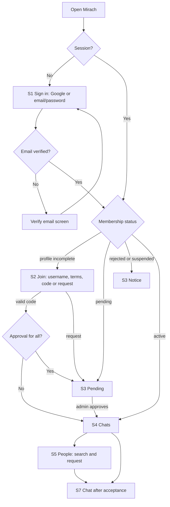

# Design — Mirach (v3)

> **Status:** UX and interaction specification v3 (frozen on owner approval). Visual tokens are proposals confirmed in Phase 1.
> **Last reviewed:** 4 November 2026 (Asia/Kolkata).
> **Authority:** Controls interaction, screens, responsiveness and accessibility. Requirements: `PRD.md`; technical constraints: `Architecture.md`.

## 1. Design philosophy

Mirach should feel like **one calm, private place** that works equally well on desktop, laptop, tablet and mobile browsers. It uses familiar patterns (conversation list, bubbles, reactions, stories) but has its own name, palette, icons and layouts; nothing is copied from existing apps.

1. **Messaging first.** Chats and people are the primary surfaces; later features appear in navigation only when shipped.
2. **Audience is always stated.** Anything shared says who can see it ("Only this chat", "Connections", "All members").
3. **Honest status.** Sending / sent / failed / offline / reconnecting / quota-limited are shown only when true. Nothing is "sent" until the server confirms; nothing is "read" unless the server recorded it and privacy allows.
4. **No gesture-only or hover-only actions.** Every gesture has a visible, keyboard-operable alternative.
5. **Accessible by default** (WCAG 2.2 AA target) and **responsive by default** (320 px to wide desktop).
6. **Safe by design.** Destructive actions confirm and state consequences; reporting is easy; no identifiers, emails or internal errors are shown.
7. **Quiet.** No streaks, no engagement nudges, no global "who's online" directory.
8. **Cloud-truth clarity.** The UI never implies data is stored on the device; local drafts are labelled; exports are described as snapshots.

Priority when principles conflict: privacy and accessibility over visual polish.

## 2. Visual system

Tokens live once in code (CSS variables mapped into Tailwind). Contrast ratios were computed on 4 Nov 2026; re-verify if values change.

### 2.1 Colour tokens (light first)

| Token | Value | Use | Contrast |
|---|---|---|---|
| `color.bg` | `#FFFFFF` | Page background | — |
| `color.surface` | `#F6F5F3` | Cards, panels, received bubbles | text on it ≥ 7.0:1 |
| `color.text` | `#1C1917` | Body | 17.49:1 on bg |
| `color.textMuted` | `#57534E` | Secondary text | 7.63:1 bg, 7.0:1 surface |
| `color.border` | `#D6D3D1` | Decorative dividers only (1.49:1) | not for controls |
| `color.borderStrong` | `#78716C` | Input/control outlines | 4.80:1 (≥ 3:1) |
| `color.accent` | `#C2410C` | Primary buttons, links, sent bubbles | white on accent 5.18:1 |
| `color.success` | `#15803D` | Success | 5.02:1 |
| `color.warning` | `#B45309` | Warnings, quota notices | 5.02:1 |
| `color.danger` | `#B91C1C` | Errors, destructive | 6.47:1 |

Dark theme: `bg #1C1917`, `surface #292524`, `text #FAFAF9` (16.74:1), `textMuted #A8A29E` (6.93:1 on bg, 6.01:1 on surface), `accent #FB923C` (7.73:1), `success #4ADE80`, `warning #FBBF24`, `danger #F87171`. Follows system preference with a manual override. Status is never conveyed by colour alone.

### 2.2 Type, spacing, shape, motion

System font stack (no external font hosts: faster, private, simpler CSP). Scale (rem): caption 0.75, label 0.875, body 1, section 1.25, page 1.5, display 2; line-height 1.5/1.25; mobile inputs ≥ 16 px. 4 px spacing base. Radius: controls 8, cards 12, bubbles 16, avatars full. At most two elevation levels. Focus ring 2 px accent with 2 px offset. Motion 150–200 ms, disabled under `prefers-reduced-motion`. One open-source icon set (licence checked); icon + text for primary actions. Touch targets ≥ 44 × 44 px.

## 3. Navigation architecture

| Item | Phase | Contents |
|---|---|---|
| Chats | 5 | Conversation list, new chat, new group, pinned/muted markers |
| People | 4 | Search, requests, connections |
| Notifications | 4 | Notification centre (bell with count) |
| Community | 10 | Announcements, feed, stories |
| Calls | 8 | History, active/incoming overlay |
| Games | 9 | Lobby, invites, history |
| Me | 4 | Profile, privacy, blocked members, sessions, your data (export), delete account |
| Admin | 3 | Role-dependent: Overview, Requests, Members, Invitations, Reports, Settings, Audit, Usage |

**Desktop (≥ 1024 px):** left rail with labels; middle column list; right detail pane; optional third info panel (conversation info, pins, shared media). **Laptop/small desktop (1024–1279 px):** info panel opens as an overlay. **Tablet (640–1023 px):** icon rail; list + detail side by side in landscape, stacked with Back in portrait. **Mobile (< 640 px):** bottom tab bar (≤ 5: Chats, People, Community or Games when shipped, Notifications, Me); list and detail are separate screens with a visible Back button; the tab bar hides inside a conversation. Admin is reached from Me on mobile.

## 4. Route map

| Route | Screen | Access |
|---|---|---|
| `/`, `/login` | S1 Welcome and sign-in | Everyone |
| `/join` | S2 Registration and invitation | Signed in, not active |
| `/pending`, `/rejected` | S3 | Matching status |
| `/app/chats`, `/app/chats/:id` | S4 Home, S7 Private chat, S8 Group chat | Active; participant |
| `/app/chats/:id/media/:attachmentId` | S9 Media viewer | Participant |
| `/app/chats/:id/info` | Conversation info, pins, shared media | Participant |
| `/app/people`, `/app/people/requests`, `/app/people/:username` | S5, S6, profile | Active |
| `/app/notifications` | S15 | Active |
| `/app/me`, `/app/me/privacy`, `/app/me/data`, `/app/me/sessions` | S10, S16 | Active |
| `/app/community`, `/app/stories` | S11, S12 | Active, Phase 10 |
| `/app/calls` | S13 | Active, Phase 8 |
| `/app/games`, `/app/games/:id` | S14 | Active, Phase 9 |
| `/admin/*` | S17, S18 | By role |
| `*` | Not found | Everyone |

URLs never contain tokens, emails or other members' personal identifiers. Route guards are UX only; authorization is server-side.

## 5. Authentication and onboarding

### S1 — Welcome and sign-in
- **Purpose:** introduce Mirach as a private invited community; sign in.
- **Components:** name, short description, **Continue with Google**, **Email and password** (tabs: Sign in / Create account), "Forgot password", links to notice/terms/rules, small line "Private, not end-to-end encrypted".
- **Actions:** sign in/up; resend verification email; reset password.
- **Navigation:** success → by status (`/join`, `/pending`, `/app`).
- **Access:** signed out.
- **States:** loading (button spinner); cancelled popup; wrong credentials (generic "Email or password didn't match"); **email not verified** screen with Resend (cooldown, mentions the daily email limit softly); provider outage ("Sign-in is unavailable right now"); offline banner. No phone field exists anywhere.

### S2 — Registration and invitation
- **Purpose:** complete profile and choose a join path.
- **Components:** username (rules, live hint; server authoritative), display name, optional bio; checkboxes for 18+, privacy notice (states operator/provider access and no E2EE), terms and community rules; two options: **I have an invitation code** / **I don't have a code** (message to admins).
- **States:** username taken/reserved/invalid; generic wrong-code message; too many attempts; network error; submit disabled while pending.

### S3 — Pending, rejected, suspended
Neutral status screens with date, withdraw/re-apply date, sign out, delete account. No member data or content shown. Loading, error and retry states.

## 6. People, profiles and connections

### S5 — Member discovery
Search (min 3 characters), results (avatar/initials, name, @username, relationship chip), "Load more", empty/rate-limited/error states. Members with "exact username only" appear only on exact match.

### S6 — Connection requests
Tabs Received · Sent · Connections; Accept/Decline/Cancel/Message/Remove; state changes only after server confirmation; destructive actions confirm.

### Member profile
Avatar, name, @username, bio (as visibility allows); actions by relationship (Send request, Cancel, Accept/Decline, Message, Remove, Block, Report). Blocking explains consequences first.

### S10 — Own profile editing
Avatar (initials until Phase 6; then upload → crop to square → preview → compress → save), display name, bio with counter, username (30-day change rule explained), discoverability. Explicit Save with success only after server confirmation.

## 7. Messaging

### S4 — Home / Chats
- Header: title, bell, new chat/group; announcement banner (Phase 10); search in list.
- List rows: avatar, name, last-message preview ("Photo", "Voice message", "Deleted message" labels), time, unread badge, mute, pin icon.
- **States:** skeleton, empty ("No chats yet. Connect with someone in People."), error/retry, reconnecting banner, quota banner ("Mirach has reached today's limit. Messages will send after midnight UTC" — wording per Arch §19.3), removed-from-chat row.

### S7 — Private chat / S8 — Group chat
- **Header:** name/avatar, online/last seen (if allowed), call buttons (Phase 8), **More** menu (info, search, mute, block/report in DMs; members, leave in groups).
- **Thread:** date separators; bubbles with text and time; sent/received distinguished by alignment **and** an accessible label; reply preview chip; reactions row under the bubble; "edited" label; "Forwarded" label; "deleted" tombstone; pinned-message bar (shows pin count, tap cycles); system messages for joins/leaves; media thumbnails/voice player/documents; "jump to latest"; unread divider.
- **Status line:** Sending… / Sent / Delivered / Read — each only when the server confirmed it and privacy allows. Failed → "Not sent — Retry / Edit / Delete".
- **Composer:** multiline text, Emoji, Attach (photo, video, voice recorder, document), Send; reply/edit banners above input with Cancel; draft kept in the local outbox (labelled "Draft"). Enter sends on desktop (setting), Shift+Enter newline; mobile uses the Send button.
- **Typing indicator** line in the header/footer ("Asha is typing…"); screen readers get a polite, throttled announcement.
- **Read-only state:** blocked/not connected → composer replaced by an explanation.
- **Group info panel:** participants and badges, add/remove members, make/remove admin, group name/avatar, pinned messages, shared media, mute, leave (explains history loss), report.
- **Revoked access:** full-screen neutral state with a way back; caches purged.
- **Offline:** composer stays usable for drafts; sends queue as "Not sent" with Retry (never "Sent").

### Message actions (all entry points open the same menu)
Actions: Reply · React · Copy · Forward · Pin/Unpin · Edit (own, 15 min) · Delete (opens a dialog) · Report (others' messages) · Info (who reacted/read, groups). 
- **Delete dialog:** "Delete for me" (only removes it from your view) and, for allowed messages, "Delete for everyone" (removes it for all participants, including media; cannot be undone). Each option states the consequence; Cancel is the default focus.
- **Edit mode:** message text loads into the composer with an "Editing" banner; save disabled when unchanged; conflict shows "This message changed. Review" with the latest text.
- **Reaction picker:** quick row of six frequently used emoji plus a full emoji picker (searchable, keyboard navigable). Toggling your own reaction removes it; reaction chips show counts; opening a chip lists reactors.

### Forward and search
- **Forward:** choose up to 5 conversations from a searchable list; preview with "Forwarded" label; progress and failure per target.
- **Search in conversation:** header search field; results list with date; tap jumps to the message; message "Search limited to recent messages — load older" when the bounded scan ends; rate-limit message.

### S9 — Media viewer
Full-screen image/video, close, previous/next within the conversation, download (if allowed), report, caption/time; focus trapped; keyboard arrows; pinch/zoom on touch with +/- buttons for desktop and assistive users. Signed URLs refresh silently once; if access is lost: "This media is no longer available to you."

### Media composer flows
- **Photo:** pick/take → preview → automatic resize (note "Location data is removed") → progress with Cancel → thumbnail appears → send.
- **Video:** pick/record → trim notice if > 60 s → on-device compress with progress ("Preparing video…") or reject with a size explanation → upload with progress → send.
- **Voice message:** hold-to-record **or** tap-to-start/tap-to-stop (the tap mode is the accessible default); timer, level meter, lock, cancel (slide **or** Cancel button), preview, send; permission-denied help.
- **Documents:** type/size explained; download-only badge.
- Upload states: queued, uploading (percent), processing (server verification), failed (Retry), cancelled; quota messages ("Your media storage is full. Delete older media or ask an admin").

## 8. Notifications, settings and privacy

### S15 — Notification centre
Items for connection requests/acceptances, membership decisions, announcements, missed calls, game invites; tapping navigates; mark all read; empty "You're all caught up"; no message text. **Web Push opt-in** card explains what is sent (generic "New message" by default; previews are an opt-in) and the iOS Home Screen requirement; permission-denied help.

### S16 — Settings and privacy
Sections: **Account** (sign-in method, sign out, **sign out of all devices**, active sessions list with revoke); **Privacy** (who can find me; read receipts; last seen; online status; typing indicator; profile photo visibility — each with a one-line explanation and the reciprocity note); **Notifications** (push, previews, default mute); **Blocked members**; **Your data** (see below); **Delete account**; **Appearance**; **About** (version, notice, terms, rules, "Not end-to-end encrypted", "Hosted on Cloudflare, Firebase and Backblaze").

**Your data (export, `/app/me/data`):** explains that all data stays online and that an export is a **snapshot you choose to download**; scope selector (my profile and settings, selected conversations, date range, my media, everything I can access); live preview of counts and estimated size; encryption option (passphrase; strength meter; required wording that the passphrase cannot be recovered); Start; progress with Pause/Resume/Cancel; completion screen with file name, manifest checksum and a reminder to store the file securely and that deleting online content later does not delete the downloaded copy. Failure/expiry states: "Export paused — resume" / "This export expired — start a new one".

**Delete account:** consequences list; choice **Keep my messages (shown as "Deleted member")** or **Delete all my messages for everyone**; re-sign-in; typed confirmation; 14-day grace with Cancel; confirmation screen.

## 9. Calls (Phase 8)

Call history (name, type, time, duration, missed/declined); call buttons in DM headers; **incoming-call overlay** (caller, voice/video, Accept, Decline, 45 s timeout, ringing via realtime or Web Push) — fully keyboard/screen-reader operable with an announced alert; outgoing "Ringing…" with Cancel; in-call controls: mute, camera, speaker/device picker, end, quality indicator, reconnecting banner; group call tiles (≤ 6) with active-speaker highlight and a participant list. States: permission denied (how to re-enable), device unavailable, busy, declined, missed, failed, **calling unavailable (quota)**, blocked/not connected (buttons absent). Copy never implies ringing when the browser is closed and no push is registered.

## 10. Games, feed, stories and announcements (Phases 9–10)

- **S14 Games:** lobby (invite a connection, active sessions, history), per-game screens: tic-tac-toe and Connect Four (large tap targets, keyboard cell navigation, clear turn indicator, legal-move feedback), **chess** (board with keyboard move entry in algebraic notation plus drag/tap, move list, resign/draw offer, clocks), **quiz** (question, timer, answer buttons, live scoreboard). Result shown only after server confirmation; reconnect restores authoritative state; opponent-disconnected and forfeit states.
- **S11 Community:** announcements (pinned first, admin-only composer) then feed with composer showing the **audience selector before posting**; reaction bar, comments (one nesting level), report on every item, load-more.
- **S12 Stories:** tray with unseen rings (plus text label), viewer with segmented progress and Pause (press **or** button), expiry time shown, "Seen by" for the author, audience chosen before posting, expired = unavailable. No auto-advance for users with reduced motion unless they choose it.

## 11. Administration and moderation

### S17 — Admin dashboard
Overview (pending requests, active members, open reports, expiring invitations, **usage panel**: Cloudflare/B2/LiveKit usage entries and 70 % warnings — entered or linked by the owner and `/api/admin/usage` counters; no private content); Requests (approve/reject with confirmation); Members (search, status/role, suspend/restore with effect explanation, role change by owner); Invitations (create → code shown once with Copy and warning; list; revoke); Settings (registration open, approval-for-all, group size, media quotas); Audit log (read-only table); **Exports** (administrative report export for admins; **operator export** for the owner with a warning panel stating it may contain private messages, requires re-sign-in and typed confirmation, mandatory encryption passphrase, and that an audit entry will be created).
**States:** every table has loading/empty/error; destructive actions confirm.

### S18 — Moderation and reports
Queue (status, category, reporter, target, age); detail shows **only the evidence snapshot** and report metadata; actions Dismiss, Warn (notification to member), Escalate; Suspend for admins/owners; resolution reason; all logged. Member-side report sheet: category, optional details, a plain list "These messages will be shared with moderators: …", Submit, confirmation.

## 12. Component architecture

- **Primitives** (`src/components/ui`): Button, IconButton, TextField, TextArea, Checkbox, Switch, Select, Avatar (image or initials), Badge/Chip, Dialog/Sheet, Menu (accessible context menu), Toast, Tabs, Skeleton, EmptyState, ErrorState, Banner (offline/reconnecting/quota), Progress, EmojiPicker, VisuallyHidden, Tooltip.
- **Layout:** AppShell (rail/tab bar), ListDetailLayout, InfoPanel, AdminShell.
- **Feature modules:** `auth`, `onboarding`, `membership`, `people`, `connections`, `chats` (ConversationList, MessageThread, MessageBubble, ReplyPreview, ReactionBar, Composer, VoiceRecorder, PinBar, ForwardDialog, SearchPanel, GroupInfo), `media` (pipelines for image/video/voice, ImageViewer, upload manager), `notifications`, `profile`, `settings`, `exports` (builder, progress, encryption), `reports`, `admin`, `calls`, `games`, `community`, `stories`.
- **State:** server state via TanStack Query; realtime signals trigger targeted refetches; local UI state in components; the outbox in IndexedDB; one session provider (UX only). All data access through `src/lib/api`.
- **Conventions:** named exports, typed props, no `dangerouslySetInnerHTML`, centralized strings, every data component renders loading/empty/error/offline/revoked/quota states.

## 13. Key user flows

Message send: compose → pending bubble ("Sending…") → API returns `seq` → "Sent" → recipient signal → fetch → delivered ack → read cursor → "Read" (if allowed). Failure at any step → explicit "Not sent" with Retry; nothing shows as sent unless confirmed.

## 14. Responsive behavior

Mobile-first CSS with fluid layouts; no fixed widths that overflow; composer, dialogs and menus respect viewport height and safe-area insets; the on-screen keyboard must not hide the composer; menus convert to bottom sheets on touch widths; the conversation info panel is a right panel on desktop, overlay on laptop/tablet, full screen on mobile; image grids reflow; admin tables scroll horizontally inside a container; the emoji picker adapts (popover on desktop, sheet on mobile); drag-and-drop file upload on desktop plus the Attach button everywhere. Test current stable Chrome, Edge, Firefox and Safari on desktop and mobile and record versions per release; verify at 320, 375, 768, 1024, 1280 and 1920 px widths, portrait and landscape.

## 15. Accessibility (WCAG 2.2 AA target) and gesture alternatives

- Semantic landmarks and headings; skip link; full keyboard operation; logical focus order; visible focus; Escape closes dialogs/sheets and restores focus; focus is trapped in modals.
- Labels and errors programmatically associated; non-blocking messages `aria-live="polite"`, blocking errors `assertive`.
- New messages in the open conversation are announced politely and never per keystroke; typing indicator announcements throttled; unread counts have text alternatives.
- Contrast per §2.1; status never by colour alone; targets ≥ 44 px; text zoom to 200 % and reflow at 320 px; `prefers-reduced-motion` and `prefers-color-scheme` respected.
- Icon-only buttons have names; images have alt text (decorative = empty); media viewer announces position ("Image 3 of 12").
- Test with keyboard only, a screen reader on at least one desktop and one mobile browser, and Axe in CI for key screens.

**Gesture alternatives (all required):**

| Gesture/hover action | Always-available alternative |
|---|---|
| Swipe a message to reply | Reply item in the message menu; visible "Reply" button on focus/hover/long-press sheet; keyboard `R` when a message is focused |
| Long-press for actions | **More (⋯) button** on each message (shown on focus and keyboard navigation; always visible in screen-reader mode); `Shift+F10`/Menu key |
| Desktop right-click | Same menu opens on right-click and on the keyboard keys above |
| Hold-to-record voice | Tap to start / tap to stop mode (default for accessibility settings) |
| Slide-to-cancel recording | Cancel button |
| Double-tap to react | Reaction button in the menu; `E` opens the picker on a focused message |
| Press-and-hold story pause | Pause button |
| Pinch zoom | Zoom +/- buttons and keyboard `+`/`-` |
| Hover-only tooltips/timestamps | Timestamps visible or on focus; tooltips also on focus |

Arrow keys move between messages in the thread (roving tabindex); `Enter` opens the menu; `Home/End` jump to oldest loaded/latest.

## 16. Shared states

Every data-driven screen defines: **loading** (skeleton, no layout jump), **empty** (what this is, what to do), **error** (plain words, safe retry, no stack traces or IDs), **offline/reconnecting** (persistent banner; composer queues drafts as "Not sent"), **permission-denied/access-revoked** (neutral, a way back; never reveals whether a resource exists), **quota-limited** (names the limit in plain words — "today's limit", "media storage full", "calling unavailable this month" — what still works, when it resets; no payment prompts), **provider outage** (sign-in unavailable, media unavailable; text still works), and **success** (only after server confirmation). Local outbox items always show "Not sent" until confirmed and "Draft" when unsent by choice.

Copy: calm, plain, respectful; never blames the user; never exposes database errors, tokens, IDs or security-sensitive reasons; invitation and sign-in errors stay generic; dates in the viewer's locale with absolute times on focus/long-press.

## 17. Design acceptance checklist

- Layouts work at 320 px to wide desktop without horizontal page scroll; all four device classes covered.
- Sign-in (Google and email/password) is distinct from community approval; unverified emails cannot proceed.
- Pending/rejected/suspended users never see member-only data.
- No screen or response exposes email, provider IDs or other private identifiers.
- Message, connection, block and read states reflect server-confirmed truth; delete/edit/report flows state their consequences.
- Every gesture has a visible, keyboard-operable alternative (§15).
- Private media never renders through a permanent or public URL.
- Every screen has loading, empty, error, offline, revoked and quota states where applicable.
- Only released features appear as enabled navigation.
- "Not end-to-end encrypted", operator/provider access, 18+ and the exports-are-snapshots statements appear in onboarding and Settings → About/Your data.
