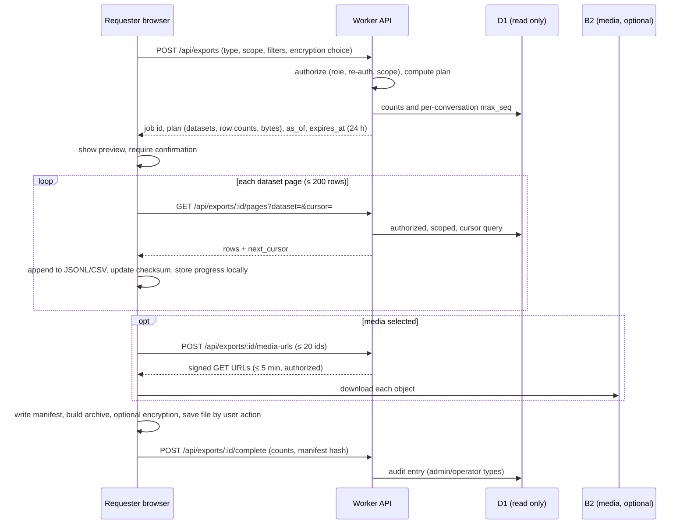

# Export Specification — Mirach (manual, user-initiated data export)

> **Status:** Specification v1 (frozen on owner approval). Implemented in Phase 11. **Planned only.**
> **Last reviewed:** 4 November 2026 (Asia/Kolkata).
> **Replaces:** every earlier idea of automatic synchronization, archiving or personal-server collection. Those are removed and prohibited (`Rules.md` §2, §23).

## 1. Principles

1. **The cloud stays authoritative.** An export is a **snapshot file**, not a replica. The personal computer is never a live database, sync destination or required backup.
2. **Manual only.** Every export is started by an authorized person clicking Export, after a preview. There is **no scheduled, background, automatic or "sync" export** anywhere. No export is downloaded without the user's explicit save action.
3. **Exporting never changes online data:** nothing is deleted, redacted, flagged or re-timed; retention rules are unaffected; deleting a message later does not delete downloaded copies.
4. **No secrets:** never passwords, OAuth secrets, session tokens/hashes, cookies, CSRF values, push subscription keys, Firebase service-account keys, provider credentials, invitation raw codes, signing keys, passphrases.
5. **Least data:** scoped to what the requester may already see; categories and date ranges are selectable; the preview shows exactly what will be included.
6. **No server-side export package:** the browser assembles the file from authorized, paginated API calls. Mirach servers never store a complete export, so there is nothing on the cloud to leak or expire (except short-lived job metadata).
7. **Honest about limits:** the free Workers/D1 quotas bound export size and speed; exports are resumable and may take several days for very large media sets.

## 2. Export types

| ID | Type | Who | Contents | Formats |
|---|---|---|---|---|
| E1 | **Full application database export (operator export)** | **Owner only** | All core, chat and activity tables except excluded secrets; optional message bodies and media | JSONL (one file per table) + CSV for tabular admin data + manifest; optional media; **SQL via the owner's own `wrangler d1 export`** (§11) |
| E2 | Selected conversation | Any active member (own conversations only) | Messages the member may see (excluding hidden-for-me; tombstones for deleted), replies, reactions, pins, participant list, attachment metadata | JSONL + readable `conversation.html`/`.txt` + manifest |
| E3 | Selected group conversation | Member of the group | As E2 plus group info and admin roles; history only from the member's join point | same |
| E4 | Selected date range | Any export that supports it (E2, E3, E6, E7, E8) | Same as the base type filtered by `created_at` range | same |
| E5 | Selected user/profile data | Member (self); admin/owner for a member's **non-private** administrative record | Profile fields, settings, privacy, memberships/roles history, connections and blocks (own), consent records; **never email** (held only by Firebase) | JSON/CSV |
| E6 | Selected media and attachments | Member for media they can access in chosen conversations/date range; owner (operator export) for all | Original files + thumbnails + `media-index.csv` with hashes | ZIP parts + manifest |
| E7 | Account-related data (all my data) | Member (self) | E5 + authored messages + conversations the member can access + own media + post/story/comment history + game history + call history + notifications | JSONL/CSV/ZIP + manifest |
| E8 | Administrative report export | Admin, owner | Members list (username, role, status, dates), membership requests, invitations (no raw codes), reports metadata (no evidence text unless escalated), audit logs, usage/quota summary | CSV + JSON + manifest — **no private message content** |

## 3. Architecture



- **Authorization at every page:** the Worker re-checks membership/role for each page, so a member removed from a group mid-export stops receiving that group's data; the manifest records `access_revoked` for the dataset.
- **Snapshot semantics:** at job creation the server records `as_of_ms` and, per conversation, `max_seq`. Messages with `seq > max_seq` are excluded. **Content is read live at fetch time**, so a message deleted after the job started is exported as a tombstone, never as its original text. The export is therefore a best-effort point-in-time cut, **not** a transactionally consistent database snapshot; the manifest says so.
- **Resumability:** progress (dataset, cursor, byte count, running SHA-256) is stored in IndexedDB. Resume is possible within the job lifetime (24 h). After expiry the user starts a new job (optionally with a narrower date range to avoid repeating completed parts).
- **Browser output:** Chromium-based browsers stream to a user-chosen file with the File System Access API; other browsers produce multiple **parts ≤ 200 MB** downloaded by explicit user action. Memory use is bounded by streaming and chunking; the UI warns before very large selections.
- **Limits:** page size ≤ 200 rows; ≤ 2 active jobs per user; media URL requests ≤ 20 ids per call; per-job and per-day row budgets (§9).

## 4. Authorization

| Type | Member | Group admin | Moderator | Admin | Owner |
|---|:-:|:-:|:-:|:-:|:-:|
| E2, E3 (own conversations) | ✔ | ✔ | ✔ | ✔ | ✔ |
| E5/E7 (self) | ✔ | ✔ | ✔ | ✔ | ✔ |
| E5 (another member's administrative record) | ✘ | ✘ | ✘ | ✔ | ✔ |
| E6 (own accessible media) | ✔ | ✔ | ✔ | ✔ | ✔ |
| E8 (administrative report) | ✘ | ✘ | ✘ | ✔ | ✔ |
| **E1 operator export** | ✘ | ✘ | ✘ | ✘ | ✔ (controls in §5) |

All types need an active session; E1, E7, E8 and cross-member E5 additionally need `reauth_at` within 5 minutes. A moderator or admin never receives other members' private conversation content, except the owner's operator export under §5.

## 5. Operator (full) export controls

The owner explicitly requires the ability to export the full database. Because that includes other people's private messages, it is gated and disclosed (`Architecture.md` §15.6, `PRD.md` §10):

1. Owner role + fresh sign-in (≤ 5 minutes) + typed confirmation phrase (`EXPORT ALL MIRACH DATA`).
2. A warning panel lists what the export contains, whether **message bodies** and **media** are included (separate checkboxes; bodies default **unchecked** per OD-14 default, ticked deliberately), the destination handling rules (§8) and that an audit entry will be created.
3. **Encryption is mandatory** (cannot be turned off); passphrase ≥ 16 characters with a strength meter; the UI states that the passphrase cannot be recovered.
4. An `audit_logs` row records actor, time, scope, row counts and manifest hash (never the passphrase or contents); other admins see it.
5. Rate/budget limits: one operator export job per day, row cap per job (§9).
6. No scheduled or recurring operator export exists. The owner's separate `wrangler d1 export` runs only when the owner types it.

## 6. Package format

```
mirach-export-<type>-<YYYYMMDD-HHMM>/
  manifest.json        schema_version, app_version, job_id, type, scope, filters,
                       generated_at, as_of_ms, per-dataset files + row counts + SHA-256,
                       media index with hashes, exclusions list, encryption flag, notes
  README.txt           plain-language description: snapshot, not live; how to verify hashes;
                       how to decrypt; handling and deletion advice
  data/                profile.json, settings.json, connections.csv, blocks.csv, consents.json, ...
  conversations/<conversation_id>/messages.jsonl, reactions.jsonl, pins.jsonl, members.json, conversation.txt
  media/<conversation_id>/<attachment_id>.<ext>   (+ thumbnails)
  admin/               members.csv, requests.csv, invitations.csv, reports.csv, audit.csv, usage.json
```

- Encodings: UTF-8; timestamps both Unix ms and ISO-8601 UTC; IDs as stored; display names resolved as of export time; deleted-for-everyone messages appear as `{"seq":…,"deleted":true,"deleted_at":…}` without text; hidden-for-me messages are omitted for that member; users who left appear as "Deleted member" where their account was deleted.
- `manifest.json` includes `"snapshot": true` and the statement "This file is not synchronized with Mirach; later changes online are not reflected."
- Schema versioning: `schema_version` follows the migration number; Phase 11 includes a reader test against the current schema.
- **SQL:** E1 may be complemented by the owner's own `wrangler d1 export` dump (§11); in-app SQL generation is not provided (JSONL/CSV only).

## 7. Content rules and exclusions

**Included when authorized:** data listed in §2. **Always excluded:** email addresses (never stored in D1), passwords, tokens, cookies, session records, `token_hash`, push subscription endpoints/keys, secrets, raw invitation codes (only hashes are stored and never exported), service-account material, internal rate-limit counters, other members' hidden-for-me states, evidence snapshots (except E8 summaries and operator export where policy states), storage object keys (replaced by attachment ids) and signed URLs.
**Privacy of others:** E2/E3 include messages by other participants because the requester can already read them (comparable to a chat export); the export UI says so. Blocked or removed members' later messages are not included.
**Media:** only original files and thumbnails the requester may access; deleted attachments are absent and noted.

## 8. Security and handling rules

- **Encryption:** optional for member exports, **mandatory** for E1 and for any export containing other members' content beyond the member's own conversations. Use a **reviewed library**, never custom cryptography: candidates are the `age` format (passphrase mode, scrypt) or OpenPGP symmetric encryption — chosen and dependency-recorded in a Phase 11 spike (**UNVERIFIED** until then); requirements: authenticated encryption, passphrase-based key derivation with a work factor, streaming/chunking for large files, decryptable offline with open tooling documented in `README.txt`. Passphrases are never sent to the server, logged or stored.
- **Download links:** no persistent server-held export links exist. API pages are bound to the authenticated session and job (24 h); media URLs expire in ≤ 5 minutes; an expired job or URL returns 403/410 and the UI offers Resume or New export.
- **Audit:** E1, E7 (optional), E8 and cross-member E5 write `audit_logs`; ordinary self exports increment a counter only.
- **Owner/holder handling rules (apply to anyone holding an export):** store only on an encrypted disk/volume; never upload to cloud storage, e-mail or chat; never commit to Git; keep a private register (file name, date, scope, purpose, planned deletion date; kept outside the repository); **default retention 90 days** (OD-14), then securely delete; apply **erasure requests** by deleting or regenerating affected exports within 30 days of the request; use exports only for the stated purpose (backup, legal obligation, investigation, personal copy).
- **No false assurance:** an export held on a personal computer is outside Mirach's controls; the privacy notice says so.

## 9. Quotas and limits

| Limit | Default |
|---|---|
| Rows per page | ≤ 200 (CPU < 10 ms target) |
| Jobs per user | ≤ 2 active; member exports ≤ 5 per day |
| Operator export | ≤ 1 per day |
| Rows exported per job | member ≤ 100,000; admin report ≤ 200,000; operator ≤ 1,000,000 |
| Account-wide daily export rows | ≤ 1,000,000 (≈ 20 % of the 5 M D1 daily read budget) |
| Media per job per day | ≤ 500 MB downloaded (B2 egress allowance protection); larger sets continue the next day |
| Job lifetime | 24 h |
| Archive part size (non-streaming browsers) | ≤ 200 MB |

Estimation notice in the preview: "Large exports use part of Mirach's free daily quota; this may slow other members. Prefer a date range." When Worker/D1/B2 quotas are exhausted the export **pauses** with an explanation and can resume after the reset; it never forces payment.

## 10. UI summary

Members: Settings → Your data (`Design.md` §8). Admins/owner: Admin → Exports (`Design.md` §11). Both show scope, live preview, encryption choice, progress with Pause/Resume/Cancel, completion screen (file name, checksum, handling reminder, "this is a snapshot; online data is unchanged") and failure/expiry states.

## 11. SQL backup by the owner (outside the app)

The owner may run `wrangler d1 export <database> --remote --output=<file>.sql` for `mirach-core` and `mirach-chat` (and `mirach-activity`), on their own computer, **only when the owner decides**. Rules: run at low traffic (the database may be busy during export — **UNVERIFIED**); store per §8; test importing into a **scratch** D1/SQLite database during the restore drill; never schedule it; D1 Time Travel (7 days) remains the cloud-side recovery tool. No Windows service, task scheduler job or script that runs this automatically is permitted.

## 12. Failure handling

| Case | Behavior |
|---|---|
| Browser closed/crash mid-export | Progress in IndexedDB; Resume within 24 h; completed parts are verified by hash before continuing |
| Network drop | Retry with backoff; pages are idempotent (cursor-based) |
| Job expired | Pages return 410; UI offers a new export; date-range tip |
| Daily quota exhausted | Pause with message; resume after reset |
| Session expired / re-auth required | Prompt to sign in again; job continues if still valid |
| Access revoked for a conversation | Dataset marked `access_revoked`; export continues for others |
| B2 outage / URL expired | Media step retries with fresh signed URLs; failures listed in the manifest |
| Storage on the user's device full | File write error shown; no data lost online |

## 13. Test requirements (Phase 11)

Completeness against live data; tombstone-only for deleted messages; hidden-for-me omitted; exclusions (no email/session/secrets) verified by scanning outputs; authorization matrix through the API; re-auth enforcement; encryption round trip and wrong-passphrase failure; resume after interruption; job expiry; quota pause; manifest checksum verification; operator export audit row; **no automatic/scheduled export exists** (code search and runtime check); export never alters online rows (before/after row counts and hashes); budget measurement for rows read; browser matrix for streaming vs multi-part output.

## 14. Explicitly not allowed

Automatic or scheduled exports; downloading exports without a user action; sending exports to the owner's PC through a service, tunnel, sync client or e-mail; storing the full export on any Mirach server; exports that include secrets or emails; unencrypted operator exports; exporting on behalf of someone else without the permissions in §4; deleting or modifying cloud data because an export was made.
