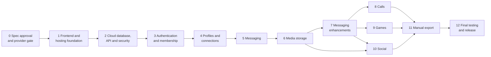

# Phases — Mirach (v3)

> **Status:** Dependency-driven roadmap v3 (frozen on owner approval). **No phase is complete** until its acceptance criteria are tested and recorded.
> **Last reviewed:** 4 November 2026; consistency pass v3.1 on 9 November 2026 (Asia/Kolkata). No implementation dates are estimated.
> **Authority:** Controls sequence, gates and exit criteria. Requirements: `PRD.md`; design: `Architecture.md`, `Design.md`.

## 1. Delivery strategy

Build in vertical slices behind exit gates. **All requested features are assigned to a phase** (§3); none is dropped. The owner's phase list (0–12) is kept, with **one technically necessary reorder**:

| Change | Reason (ADR-027) |
|---|---|
| The former "Cloud database and security" phase is now **Phase 2**; "Authentication and membership" is **Phase 3**; "Profiles and connections" is **Phase 4** | Invitations, approvals, profiles and sessions cannot exist without D1 tables, the Worker API, the authorization layer and rate limiting. Phases 5–12 keep the owner's numbering |
| **Avatar upload** moves from Profiles to **Phase 6** (Media); Phase 4 ships generated initials avatars | Avatars need the private media pipeline |
| **Backblaze activation** is tested in **Phase 0** (Gate P) | Media is frozen only if no-card activation is proven by the owner |

Other order differences from v2 (Supabase plan) are void; v2 phases are superseded.

Release points: **trusted-group release** after Phase 7 (Gate B); **full release** after Phase 12 (Gate C).

## 2. Dependency roadmap

Key dependencies: D1 + authorization (2) → everything; membership (3) → connections (4) → DMs (5); conversation membership (5) → media authorization (6) → calls/social; Web Push and presence (7) → incoming-call ring when closed (8); media pipeline (6) → stories/posts (10); every data-bearing phase (≤ 10) → complete export coverage (11). Phases 8, 9, 10 are independent after Phase 7 and may be reordered by the owner (not skipped).

## 3. Feature-to-phase matrix

| Feature (owner list) | Phase |
|---|---|
| Google authentication; email/password (verification, reset) | 3 |
| Unique usernames; invitation-only registration; admin-approved registration | 3 |
| Administrator and moderator roles; audit log; admin dashboard | 3 (core), 4 (audit viewer), 12 (usage panel final) |
| Member profiles, display names, biographies | 4 |
| **Profile photographs** (initials in 4; upload in 6) | 4 / 6 |
| Privacy controls (discoverability, read receipts, last seen, online, typing, photo visibility) | 4 (settings), 5 and 7 (effects) |
| Blocking and reporting | 4 (members), 5–10 (content) |
| Friend requests / connections | 4 |
| One-to-one chat; group conversations; group administration | 5 |
| Text messages; unread counts; delivered/read receipts; typing indicators | 5 |
| Reply to messages; emoji reactions and picker; edit; delete for me; delete for everyone | 5 (media-aware deletion completes in 6) |
| Swipe to reply; long-press actions; context menus; desktop right-click; keyboard and accessibility alternatives | 5 |
| Photos; videos; voice messages; attachments | 6 |
| Message search; forward; pin; conversation muting | 7 |
| Online presence; last seen with privacy controls | 7 |
| Notifications (in-app centre basic in 4; push/PWA in 7) | 4 / 7 |
| Voice calls; video calls; incoming call notifications; accept/reject; missed-call history | 8 |
| Group calling (later milestone inside Phase 8) | 8 |
| Private game rooms and invitations; game history; server-validated moves | 9 |
| Tic-tac-toe; Connect Four; multiplayer quizzes; chess | 9 |
| Posts; community feed; likes and reactions; comments; temporary stories; shared media; audience and visibility controls; community announcements | 10 |
| Manual data export (full database/operator, selected conversations, groups, date ranges, profile data, media, account data, administrative reports; JSON/CSV/ZIP/SQL via CLI; encryption) | 11 |
| Account deletion and data lifecycle (request flow in 3; execution job in 6; verification in 12) | 3 / 6 / 12 |
| Responsive layouts for desktop, laptop, tablet, mobile; accessibility | 1 (shell), every phase, 12 (verification) |
| Quota monitoring, failure handling, outbox | 2, 5, 12 |

## 4. Launch gates

| Gate | When | Must be true |
|---|---|---|
| **P — provider activation** | End of Phase 0 | The owner has created Cloudflare, Firebase (Spark) and GitHub accounts and a Backblaze B2 account **without payment details**; B2 private bucket, scoped application key, CORS, presigned PUT/GET and versioned delete tested by a script; no card requested at any step; results recorded in `SOURCE_REGISTER.md`. **If B2 fails**, media features are blocked and an ADR for an alternative (own no-card test) is required before Phase 6 |
| **A — first real person** | After Phase 3 | Owner bootstrap done; auth/membership tests pass; privacy notice, terms, 18+ declaration live; no secrets in repo/bundle; first D1 Time Travel/restore test; sessions revocation tested |
| **L — LiveKit activation** | Start of Phase 8 | Owner creates a LiveKit Build project with no payment details; token minting spike passes; quota behavior documented |
| **B — trusted-group release** | After Phase 7 | Release criteria 1–6 and 8 (`PRD.md` §17) for implemented features; failure-matrix tests for implemented features; usage thresholds and checklist in place; restore drill recorded; known limitations published; second admin appointed |
| **C — wider rollout / full release** | After Phase 12 | All `PRD.md` §17 criteria; legal review done (OD-07/OD-08); DPDP readiness before 13–14 May 2027 if applicable; performance and accessibility results recorded; owner approval |

## 5. Testing strategy

**Layers:** unit (validation, state machines, policy functions) → worker/API tests in the Cloudflare Workers test pool against local D1/DO (policy, SQL patterns, idempotency) → component tests → end-to-end Playwright with **two or more independent users and real browsers** → manual (devices, screen reader, slow/offline network) → security review before each gate.

**Rules:** positive tests never pass a privacy feature alone; every private resource has negative tests through the **HTTP API**; bug fixes add regressions; CI blocks merges; synthetic data only; migrations tested from scratch.

**Negative-test matrix** (extended every phase):

| Actor ↓ / Resource → | Directory | Connections | Conversation + messages | WebSocket/rooms | Attachments (signing) | Admin API | Reports/audit | Export API |
|---|---|---|---|---|---|---|---|---|
| Signed out | deny | deny | deny | deny | deny | deny | deny | deny |
| Pending/rejected/deleted | deny | deny | deny | deny | deny | deny | deny | deny |
| Suspended | deny | deny | deny | deny | deny | deny | deny | deny |
| Active non-participant | allowed fields | own only | **deny** | **deny** | **deny** | deny | own reports | own scope only |
| Former group member | — | — | deny | deny | deny | — | — | no access to history after leaving |
| Blocked party | — | cannot request | DM read-only | — | — | — | — | — |
| Moderator/admin as non-participant | — | own only | **deny** | **deny** | **deny** | by role | evidence only | admin report export only |
| Owner | — | own only | participant only | participant only | participant only | allowed | allowed | operator export with controls |
| Forged inputs | forged `user_id`, role, sender, seq, status, `Origin`, CSRF header, session cookie of another user all rejected | | | | | | | |

**Required failure tests (owner list, Arch §19.3 behaviors):**

| ID | Scenario | First phase |
|---|---|---|
| F-01 | Firebase authentication failure/outage (existing sessions keep working) | 3 |
| F-02 | Worker unavailable / error 1027 (shell loads, API fails, outbox safe) | 2 |
| F-03 | D1 read/write daily limit reached (503, no false success) | 2 |
| F-04 | D1 database full (inserts fail, reads continue, no deletion) | 5 |
| F-05 | Durable Object disconnection/reconnect catch-up | 5 |
| F-06 | B2 unavailable | 6 |
| F-07 | Media upload failure/interruption/cancel | 6 |
| F-08 | Media download failure and signed-URL expiry | 6 |
| F-09 | Duplicate message requests (idempotency) | 5 |
| F-10 | Slow network and timeouts | 5 |
| F-11 | Browser refresh during send/upload/export | 5 |
| F-12 | Session expiration | 3 |
| F-13 | Unauthorized attachment access | 6 |
| F-14 | Account suspension (immediate effect, sockets) | 3 |
| F-15 | Member blocking effects | 4–5 |
| F-16 | Message deletion (no reappearance via cache/export) | 5–6 |
| F-17 | Account deletion (both message modes) | 3 request, 6 execution, 12 verification |
| F-18 | Export interrupted and resumed | 11 |
| F-19 | Export link/job expired | 11 |
| F-20 | Provider quota exhaustion (each provider) | 2–12 |

**Other suites:** invitation concurrency (many parallel redemptions → exactly `max_uses`); `seq` gap-free under concurrent sends; D1 batch semantic spike; write/read-row budget measurement per feature; CPU-time measurement per handler (< 10 ms target); WebSocket revocation; magic-byte/MIME validation; export manifest and checksums; accessibility (Axe + manual); cross-browser/device matrix; small load test (25 simulated users) before Gate C.

## 6. Phase 0 — Final specification approval and provider gate

- **Objective:** freeze architecture, database, auth provider, hosting, storage provider, scope and sequence on evidence.
- **Dependencies:** none.
- **Components:** owner review of the eleven documents; answers to `DECISIONS.md` §3 or acceptance of defaults; provider activation per Gate P; documentation freeze checklist (`REVIEW_REPORT.md` §11); create private GitHub repo and place documents in `/docs`.
- **Database changes:** none.
- **Security considerations:** two-factor on GitHub, Cloudflare, Google/Firebase, Backblaze; no secrets in documents; no card entered anywhere.
- **Tests:** Gate P script results recorded; documents' cross-references checked.
- **Acceptance criteria:** owner approval recorded in `DECISIONS.md`; Gate P passed (or B2 ADR path chosen).
- **Definition of Done:** §19 documentation items.
- **Exit gate:** Gate P + approval = **architecture freeze**.

## 7. Phase 1 — Frontend and hosting foundation

- **Objective:** a deployed, responsive, secure empty shell with the Worker skeleton.
- **Dependencies:** Phase 0.
- **Components:** Vite + React + TypeScript (strict) + Tailwind; tokens; responsive AppShell (rail/tab bar/list-detail), routes with guards (UX only), error boundaries, offline/quota/maintenance screens; Worker with Static Assets (SPA fallback, `run_worker_first` for `/api/*` and `/ws/*`), `_headers` (CSP etc.), `/api/health`; GitHub Actions CI + staging deploy; `.env.example`; Firebase web SDK wired with config only; spike: Firebase authorized domain on `workers.dev`, popup vs redirect sign-in, `/__/auth` proxy need, CSP entries for Firebase.
- **Database changes:** none.
- **Security considerations:** headers verified in browser; bundle inspected for secrets; exact Firebase authorized domains; no tokens in URLs.
- **Tests:** deploy smoke, deep-link refresh, headers, backend-down state, responsive snapshots at 320/768/1024/1280, Axe on the shell.
- **Acceptance criteria:** push → staging deploy; production and staging separated; shell usable on all four device classes.
- **Definition of Done:** §19.
- **Exit gate:** deployed staging URL passes the checks; spike results recorded.

## 8. Phase 2 — Cloud database, Worker API and security foundation

- **Objective:** the authoritative data layer and the security spine every later phase uses.
- **Dependencies:** Phase 1.
- **Components:** D1 databases (`mirach-core`, `mirach-chat` stub; staging single DB), migration tooling and conventions, `src/worker/data` layer, request pipeline (rate limit, Origin/CSRF, session lookup stub, validation with Zod, error format, request IDs), `authorize()` policy module, rate-limit binding spike, usage counters/`/api/admin/usage` stub, logging with redaction, quota-exhausted error handling (503 `QUOTA_EXHAUSTED`), Durable Object skeleton classes, cron skeleton.
- **Spikes (must record results):** D1 `batch()` atomicity/rollback and statement ordering; `RETURNING`; partial unique indexes; STRICT tables; per-handler CPU; subrequest counts (including whether Durable Object calls count against the 50 limit); migrations from scratch into one shared database (names unique across folders); Workers rate-limiting binding on Free; DO hibernation; reads/writes metrics via `meta`.
- **Database changes:** `community_settings`, `reserved_usernames`, `audit_logs` (append-only conventions), `sessions` (schema), `conversation_directory`, shared helpers.
- **Security considerations:** prepared statements only (lint-enforced); no raw DB access outside `data/`; secrets via Wrangler; error responses generic; logs without content.
- **Tests:** migration from scratch; policy unit tests; SQL pattern tests (invitation and send-message patterns on real D1 semantics); F-02, F-03, F-20 (Workers/D1); injection attempts.
- **Acceptance criteria:** pipeline rejects forged identity/Origin/CSRF; failing D1 writes never produce success responses; spike results recorded; ADRs amended if a pattern fails.
- **Definition of Done:** §19.
- **Exit gate:** spike report accepted; data layer and policy module reviewed.

## 9. Phase 3 — Authentication and membership

- **Objective:** only invited or approved people become members; sessions and administration work.
- **Dependencies:** Phase 2.
- **Components:** Firebase sign-in (Google, email/password, verification, reset); `POST /api/session` token validation (Arch §5.3); sessions, revoke, sign-out-all; re-auth; username claim; terms/18+ acceptance; invitations (create/redeem/revoke); membership requests and approval; approval-for-all; owner bootstrap; roles; suspension; admin console (requests, members, invitations, settings); audit writes; account-deletion **request** flow; Firebase Admin spike (optional hardening) with fallback.
- **Database changes:** `profiles`, `memberships`, `membership_requests`, `invitation_codes`, `invitation_redemptions`, `invitation_attempts`, `policy_acceptances`, `account_deletion_requests`.
- **Security considerations:** exact token checks; email never stored; generic invitation errors; hierarchy and last-owner rules; suspension revokes sessions; unverified email blocked; account-linking tests.
- **Tests:** F-01, F-12, F-14; concurrent redemption; role escalation attempts; token negative tests (wrong aud/iss/alg/expired/anonymous/unverified); CSRF; session revoke.
- **Acceptance criteria:** `FR-AUTH-01…07`, `FR-MEM-01…10`, `FR-PRIV-01` (request flow).
- **Definition of Done:** §19.
- **Exit gate:** **Gate A**.

## 10. Phase 4 — Profiles and connections

- **Objective:** members have profiles and explicit connections; safety basics exist.
- **Dependencies:** Phase 3.
- **Components:** profile view/edit (initials avatar), privacy settings, directory search, connection lifecycle, block/unblock, member reports + moderation queue, in-app notification centre (basic), audit viewer.
- **Database changes:** `connections`, `blocked_users`, `notifications`, `reports`; profile privacy columns used.
- **Security considerations:** canonical pair uniqueness; directory privacy and rate limits; no email/ID leakage; evidence snapshot rules.
- **Tests:** F-15 (requests); duplicate/reverse simultaneous requests; blocked cannot request; directory fields; discoverability; moderator can't see more than evidence.
- **Acceptance criteria:** `FR-PRO-01/03/04/05`, `FR-CON-01…03`, `FR-SAFE-01(member)/02/03`, `FR-ENH-07 (basic)`, `FR-MEM-08` viewer.
- **Definition of Done:** §19.
- **Exit gate:** phase tests + negative matrix rows for directory/connections green.

## 11. Phase 5 — Messaging

- **Objective:** reliable, ordered, complete cloud-stored chat with rich interactions.
- **Dependencies:** Phase 4.
- **Components:** conversations (DM/group), group administration; `send_message` batch; history pagination; `UserHub`/`ConversationRoom`/`PresenceRegistry` realtime with hibernation; signals; cursors (delivered/read); unread; typing; replies; reactions + picker; edit; delete for me/everyone (text); context menus, long-press, right-click, keyboard, swipe-to-reply with alternatives; outbox/drafts; reconnect catch-up; message reports; quota failure UX.
- **Database changes:** `mirach-chat`: `conversations`, `conversation_members`, `messages`, `message_reactions`, `message_hides`; core `conversation_directory` use.
- **Security considerations:** membership predicates in SQL; ids-only signals; room admission by Worker; revocation on removal/suspension/block; idempotency; rate limits; no content in logs; Cache-Control no-store.
- **Tests:** F-04, F-05, F-09, F-10, F-11, F-15, F-16; negative matrix (conversation, WebSocket); concurrent `seq`; interrupted DM/group creation (directory row without chat row) recovers on retry with no duplicate; removed member mid-session; two-browser E2E incl. offline→reconnect; accessibility of menus/gestures; write/read budgets measured.
- **Acceptance criteria:** `FR-MSG-01…10`, `FR-INT-01…07`, `FR-SAFE-01` for messages.
- **Definition of Done:** §19.
- **Exit gate:** multi-user E2E + negative tests green; budget measurements within targets.

## 12. Phase 6 — Media storage

- **Objective:** private, validated, quota-managed media with secure deletion.
- **Dependencies:** Phase 5; Gate P (B2).
- **Components:** B2 client (SigV4 presign, HEAD, ranged GET, COPY, DELETE with version), upload/complete/sign endpoints; client pipelines for photos, videos (compression strategy and limits), voice messages, thumbnails, documents; upload manager with progress/retry/cancel; media viewer; avatars/group avatars; quotas and monitoring; deletion jobs and orphan cleanup cron; **account-deletion execution job** (keep/delete-messages modes, media purge, tombstone, Firebase removal path); bucket lifecycle rule; egress mitigations (thumbnails, caching).
- **Database changes:** `message_attachments`; avatar references; cron jobs; `account_deletion_requests` processing.
- **Security considerations:** private bucket; scoped key; type allow-list and magic-byte check; no SVG/HTML; signed URLs ≤ 5 min after authorization; delete-for-everyone removes objects and versions; per-user quota and daily caps.
- **Tests:** F-06, F-07, F-08, F-13; interrupted/cancelled uploads; wrong type/oversize; EXIF absent; expired URL; former member denied; deletion completeness (object + version); quota thresholds; reload/refresh during upload.
- **Acceptance criteria:** `FR-MED-01…08`, `FR-PRO-02`, `FR-INT-05` (media).
- **Definition of Done:** §19.
- **Exit gate:** negative attachment tests + deletion verification on real B2 (staging bucket).

## 13. Phase 7 — Messaging enhancements

- **Objective:** search, forwarding, pinning, mute, presence, notifications.
- **Dependencies:** Phase 6.
- **Components:** conversation search (bounded scan, FTS5 spike with write-amplification measurement); forward (B2 copy); pins; mute; presence and last seen with privacy rules; Web Push (VAPID, subscriptions, DO-based fan-out, generic payloads), PWA manifest + service worker; notification preferences.
- **Database changes:** `conversation_pins`; `push_subscriptions`; settings columns.
- **Security considerations:** search limited to readable messages and rate-limited; forward cannot expose the original sender or inaccessible messages; push endpoints stored securely, payloads generic; presence respects both users' settings.
- **Tests:** search privacy and cost; forward authorization; pin limits; presence visibility matrix; push subscription lifecycle; iOS Home Screen requirement documented/tested; quota consumption.
- **Acceptance criteria:** `FR-ENH-01…07`.
- **Definition of Done:** §19.
- **Exit gate:** **Gate B** (trusted-group release).

## 14. Phase 8 — Voice and video calls

- **Objective:** authorized calls within the LiveKit Build quota.
- **Dependencies:** Phase 7; Gate L.
- **Components:** LiveKit project; `call_sessions`; call APIs and state machine; token minting; incoming-call signaling via `UserHub` + Web Push; voice, then video, then group (≤ 6); device/permission handling; missed-call history; quota guard.
- **Database changes:** `call_sessions` (+ participants JSON or table).
- **Security considerations:** server-decided access; room-scoped token ≤ 10 min; secrets in Worker only; block/connection checks; no recording; CSP/Permissions-Policy updates.
- **Tests:** token authorization negatives; ring/accept/decline/cancel/timeout/busy; browsers/devices/networks; permission denied; quota exhausted; F-20 (LiveKit).
- **Acceptance criteria:** `FR-CALL-01…07`.
- **Definition of Done:** §19.
- **Exit gate:** cross-browser call tests recorded; quota behavior verified.

## 15. Phase 9 — Games

- **Objective:** server-validated multiplayer games.
- **Dependencies:** Phase 7.
- **Components:** `mirach-activity` database; invitations and rooms; `GameRoom` DO; tic-tac-toe, Connect Four, chess (`chess.js` dependency record), quiz (admin-managed question bank, alarm timers); history; resume/forfeit; spectator-free private rooms.
- **Database changes:** `game_sessions`, `game_players`, `game_moves`, `quiz_questions`, `quiz_answers`.
- **Security considerations:** only invited players; moves validated in the DO and written with `UNIQUE (session_id, move_no)`; no client-set results; DO CPU/duration within free limits.
- **Tests:** out-of-turn, duplicate, illegal, replayed moves; concurrent moves; reconnect state restore; chess rule suite (check, castling, en passant, promotion, draws); quiz timing fairness; DO duration/request budgets.
- **Acceptance criteria:** `FR-GAME-01…07`.
- **Definition of Done:** §19.
- **Exit gate:** rule suites + budget measurements pass.

## 16. Phase 10 — Social functionality

- **Objective:** audience-controlled posts, feed, stories, comments, reactions, announcements.
- **Dependencies:** Phases 6 and 7.
- **Components:** feed, composer with audience selector, comments, likes/reactions, stories with 24 h expiry cron, shared media via the Phase 6 pipeline, announcements (admin), reporting/blocking integration, quota-aware media limits.
- **Database changes:** `posts`, `post_attachments`, `comments`, `post_reactions`, `stories`, `story_views`, `announcements` in `mirach-activity`.
- **Security considerations:** audience enforced in SQL and media signing; expired stories unreachable by API/path; moderation evidence for posts/stories; rate limits.
- **Tests:** visibility per audience and block state; expiry (including cron failure fallback checks at read time); delete completeness; storage/egress measurement.
- **Acceptance criteria:** `FR-SOC-01…07`.
- **Definition of Done:** §19.
- **Exit gate:** audience negative tests + expiry verification.

## 17. Phase 11 — Manual data export

- **Objective:** user-initiated, secure, optionally encrypted exports (`EXPORT_SPECIFICATION.md`).
- **Dependencies:** Phases 5–10 data in place.
- **Components:** export jobs API (plan, pages, complete), client-side builder (JSON/CSV/ZIP + manifest, media download, resume), encryption (AES-256-GCM with passphrase), UI in Settings → Your data and Admin → Exports, administrative report export, operator export controls, audit entries, quota guards, retention/handling runbook, SQL backup runbook (`wrangler d1 export`).
- **Database changes:** `export_jobs`.
- **Security considerations:** scope authorization per row; exclusions (secrets/tokens/sessions/emails); re-auth and typed confirmation for operator exports; mandatory encryption for exports with others' content; no server-side package storage; read-budget limits.
- **Tests:** F-18, F-19; export completeness vs live data; tombstones not original text; hidden-for-me excluded; permission matrix; encryption round-trip; interrupted/resumed jobs; D1 read-row consumption; no automatic export path exists (code search + test).
- **Acceptance criteria:** `FR-EXP-01…07`.
- **Definition of Done:** §19.
- **Exit gate:** export-import drill (JSON re-validation and SQL import into scratch DB) recorded.

## 18. Phase 12 — Final testing and release

- **Objective:** verify the whole system and release.
- **Dependencies:** Phases 1–11.
- **Components:** full regression; security review (authorization, sessions, CSRF, headers, secrets); functional testing of every FR; desktop/laptop/tablet/mobile and browser matrix; accessibility audit; storage-quota tests (B2/D1/DO); provider-outage simulations; deletion testing (both account-deletion modes, message/media); recovery testing (Time Travel restore, SQL export import); performance and budget measurements; load test (25 simulated users); legal/privacy review inputs; production-readiness review; operations runbooks (backup/restore, incident, breach, secret rotation, owner recovery); privacy notice final.
- **Database changes:** none (except fixes).
- **Security considerations:** third-party-style review checklist; dependency audit; secret scan; confirm no paid/card-dependent service is configured.
- **Tests:** all failure tests F-01…F-20; full negative matrix; release candidate soak.
- **Acceptance criteria:** `PRD.md` §17 all items.
- **Definition of Done:** §19.
- **Exit gate:** **Gate C** and owner sign-off.

## 19. Definition of Done and exit rules

A phase is done only when all are true:
1. Requirements and acceptance criteria met (each `FR-*` listed for the phase).
2. Loading, empty, error, offline, quota, revoked states implemented.
3. Authorization enforced in the Worker policy layer and SQL predicates; negative tests added for every new private resource.
4. Unit, Worker/API, component and E2E tests pass, including the failure tests assigned to the phase.
5. Desktop, laptop, tablet and mobile checks pass; accessibility basics and gesture alternatives verified.
6. Write/read/request/CPU budgets measured and within `Architecture.md` §19.2 targets, or an owner-approved exception recorded.
7. No secrets or real user data committed; secret scan clean; no paid or card-requiring service introduced.
8. Migrations applied locally and on staging; rollback/restore path noted.
9. Documentation, traceability and `Memory.md` status updated.
10. A completion report (`Rules.md` §22) states what was tested and what remains unverified.

## 20. Main risks

| Risk | Mitigation |
|---|---|
| Daily D1/Worker/DO quotas | Budgets, coalescing, usage page, graceful degradation |
| 500 MB per D1 database | Separate chat DB, shard-ready design, owner ADR before scale-out |
| B2 activation/egress unknown | Gate P; text-only fallback; ADR alternatives |
| Custom authorization mistakes | Central policy, SQL scoping, negative-matrix tests every phase |
| D1 batch semantics differ | Phase 2 spike; documented fallbacks |
| Worker 10 ms CPU | Measure; heavy work in DOs (30 s CPU) |
| Firebase email limits | Spark limits recorded; resend cooldown; monitor |
| Scope creep | Freeze and change control; backlog |
| Legal timeline (DPDP) | 18+ default; counsel gate |

## 21. Prioritized next steps

1. Owner reviews `DECISIONS.md` §3 and answers or accepts defaults (especially OD-13 B2 activation, OD-14 operator access wording, OD-07 age).
2. Owner performs Gate P activations (no card) and reports results; update `SOURCE_REGISTER.md`.
3. Owner approves and signs the documentation freeze checklist.
4. Start Phase 0 repo setup, then Phase 1 shell; do not start Phase 3 before the Phase 2 spike report is accepted.
